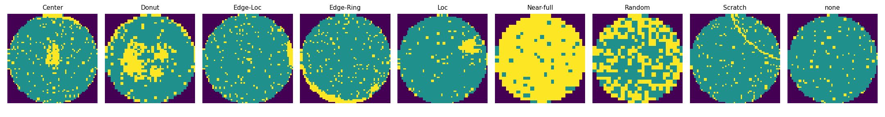
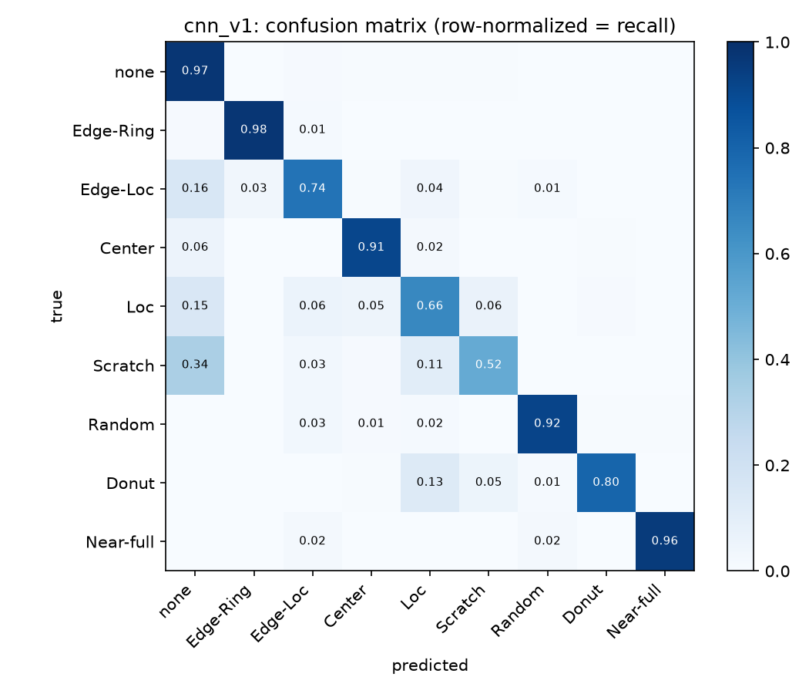
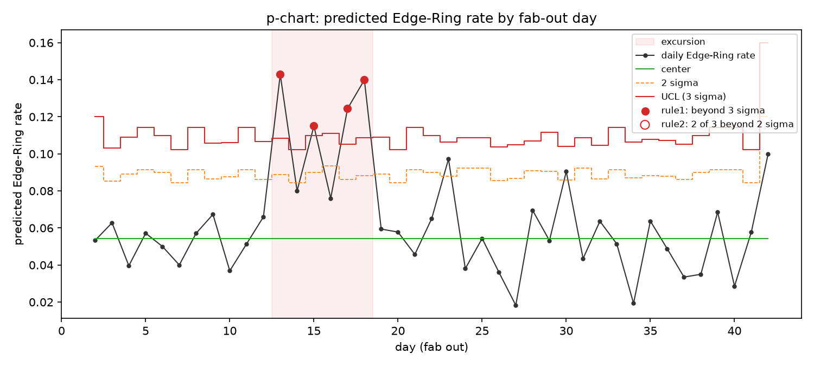
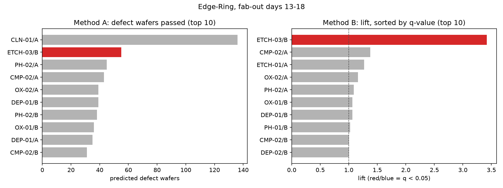
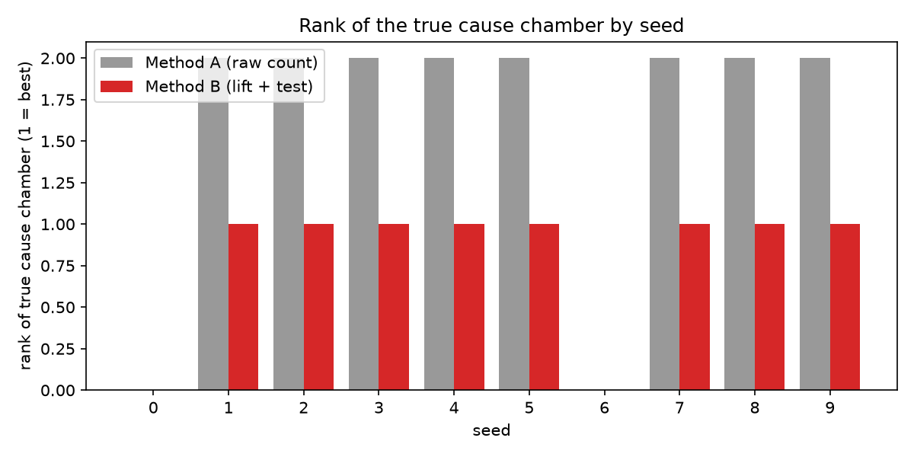

# fabtrace

Wafer defect root-cause analysis and containment on a simulated fab, built on the public WM-811K wafer map dataset.

A customer reports more Edge-Ring failures. fabtrace notices the excursion on a control chart, finds which process chamber the defective wafers have in common, and decides which lots to put on hold, the same flow a quality engineer follows in an 8D investigation. Because real fab data is not available, a known fault is injected into a simulated fab so that every step can be scored against the ground truth.

#### **Current results** (held-out seeds 0 to 9, see [E3](results/experiments/20261111-E3.md))

- Wafer map classifier:
  - macro-F1 **0.80** and Edge-Ring recall **0.976** on 51,885 maps never used for training or model selection.
- Root cause:
   - whenever the excursion was detected, the statistical method ranked the true chamber **first in 8 of 8** seeds.
   - A naive count of defective wafers was fooled by a bottleneck tool in 8 of 8.
- Weak spots found on held-out seeds:
  - excursion detection 8/10, containment lot recall 0.79 on detected seeds.
  - Chamber-level monitoring to fix both is in progress ([spec 04](docs/specs/04-chamber-monitoring.md)).

## Repository layout

```
fabtrace/
├── configs/
│   ├── fab.yaml                 # virtual fab: 6 steps, tools, chambers, lot schedule
│   └── scenarios/s1.yaml        # injected fault: ETCH-03/B, days 12-18, Edge-Ring
├── src/fabtrace/
│   ├── data/                    # WM-811K loading, train/val/fab split, training batches
│   ├── sim/                     # lot genealogy, fault injection, generate entry point
│   ├── models/                  # CNN, training loop, evaluation and predictions
│   └── analysis/                # p-chart, commonality, containment, pipeline, reports, E3
├── scripts/                     # data prep, training, evaluation, run_rca, run_e3
├── notebooks/01_sanity.ipynb    # E1: does the simulation look as intended
├── tests/                       # mirrors src/; runs on CI without the dataset
├── results/
│   ├── experiments/             # hand-written, dated experiment records, never edited afterwards
│   ├── reports/                 # generated by scripts, overwritten on each run
│   ├── figures/
│   └── logs/                    # training logs
└── docs/
    ├── specs/                   # scope and done criteria for each milestone
    └── figures/
```

#### Key documents:
Design decisions and their reasoning are recorded in each pull request and, for the larger ones, in issue comments.

1. Specs: [01 virtual fab](docs/specs/01-virtual-fab.md) · [02 classifier](docs/specs/02-wafermap-classifier.md) · [03 commonality and containment](docs/specs/03-commonality-containment.md) · [04 chamber monitoring](docs/specs/04-chamber-monitoring.md)
2. Experiments: [E1 simulation sanity](results/experiments/20261108-E1.md) · [E2 class balancing](results/experiments/20261111-E2.md) · [E3 held-out seeds](results/experiments/20261111-E3.md)
3. Reports: [classifier](results/reports/classifier_report.md) · [S1 root cause, seed 42](results/reports/s1_rca.md) · [E3 per-seed table](results/reports/e3_summary.md)

## How it works

### 1. Simulated Fab Environment

Real fab data with lot genealogy is confidential, so WM-811K wafer maps are placed onto a simulated fab where the cause is known.

- **Scale:** 8,000 wafers across 320 lots over 40 days
- **Process:** 6 process steps and 26 chambers
- **Lot routing:** Each lot enters one tool per step, and its wafers are split across that tool's chambers.
- **Deliberate confounder:** One cleaning tool processes every wafer, creating a trap for naive analysis.

### 2. Injected Defect Scenario (S1)

The simulation introduces a known chamber-level defect to evaluate whether the analysis can identify its root cause.

- **Suspect chamber:** ETCH-03/B
- **Defect pattern:** Edge-Ring
- **Exposure period:** Days 12–18
- **Injected behavior:** Wafers etched in ETCH-03/B during this period develop Edge-Ring defects.
- **Background noise:** All other wafers follow the natural WM-811K class distribution, where approximately 5% are Edge-Ring without any process-related cause.

### 3. Analysis Pipeline

The analysis runs in four steps, using only classifier predictions rather than ground-truth labels.

#### Step 1. Wafer Map Classification

- Classify each wafer map using a lightweight CNN (cnn_v1, approximately 100K parameters). T
- he virtual fab uses maps from a 30% split that the classifier never sees during training.

#### Step 2. Defect Monitoring

Monitor each defect pattern using a p-chart grouped by fab-out day.

- Control limits are calculated using exact binomial quantiles.
- A 2-of-3 beyond 2 sigma rule detects gradual but sustained increases.

#### Step 3. Root Cause Identification

Identify the common cause among wafers in the excursion window.

- Compare each chamber's defect rate against the rest of its process step using lift.
- Apply a one-sided Fisher's exact test.
- Correct for multiple comparisons using the Benjamini-Hochberg procedure.

#### Step 4. Lot Containment

- Trace every lot that passed through the suspect chamber during the exposure period.
- A 24-hour margin is added to the exposure window because the cost of shipping a defective lot is higher than that of re-inspecting a good one.

### 4. Validation

A test verifies that shuffling the ground-truth columns leaves the analysis output unchanged, ensuring that the pipeline relies exclusively on classifier predictions rather than hidden labels.

### 5. WM-811K Dataset

<details>
<summary>WM-811K class distribution and sample maps</summary>

172,950 labeled maps, downsized to 64x64 with values 0 (outside wafer), 1 (good die), 2 (defective die).

| Class | Count |
| --- | --- |
| none | 147,431 |
| Edge-Ring | 9,680 |
| Edge-Loc | 5,189 |
| Center | 4,294 |
| Loc | 3,593 |
| Scratch | 1,193 |
| Random | 866 |
| Donut | 555 |
| Near-full | 149 |

`none` accounts for 85% of labeled maps, so macro-F1 is used as the main metric instead of accuracy.



</details>

## Results

**Classifier** ([report](results/reports/classifier_report.md), [E2](results/experiments/20261111-E2.md)). Evaluated on 51,885 maps never used for training or model selection. Without class balancing the model never predicts Scratch at all.

| Model | Class balancing | macro-F1 | Edge-Ring recall | Scratch recall |
| --- | --- | --- | --- | --- |
| `cnn_v1` | yes | **0.802** | **0.976** | **0.52** |
| `cnn_v1_nobalance` | no | 0.743 | 0.947 | 0.00 |



**Root cause on the development seed** ([report](results/reports/s1_rca.md)). On seed 42 only the Edge-Ring chart raised an excursion (fab-out days 13 to 18). Among 1,201 wafers in that window:

| Method | Rank 1 | True chamber ETCH-03/B |
| --- | --- | --- |
| A: count of defective wafers passed | CLN-01/A (bottleneck, all wafers) | rank 2 |
| B: lift + Fisher + BH | ETCH-03/B, lift 3.42, q < 0.0001 | **rank 1, the only significant chamber** |

The runner-up CMP-02/A had p = 0.009 and would have been a false cause without multiple testing correction (q = 0.11). Over the whole 40 days the true chamber ranks only 17th of 26 by raw count, because ETCH chambers each handle 11% of wafers while other chambers handle 25% ([E1](results/experiments/20261108-E1.md)).





**Held-out seeds** ([summary](results/reports/e3_summary.md), [E3](results/experiments/20261111-E3.md)). Seed 42 was used to tune rules and margins, so performance is measured on new seeds 0 to 9.

| Stage | Result |
| --- | --- |
| Excursion detected | 8/10 (7/10 with the 3-sigma rule alone) |
| True chamber ranked first, when detected | 8/8 |
| Bottleneck ranked first by naive count, when detected | 8/8 |
| Lot recall with 24h margin, detected seeds | 0.79 on average |
| Wrongly named chambers | 1 in total |



Seed 42 turned out to be a lucky seed with a long excursion window. A fab-wide chart dilutes a single chamber's signal, and the exposure period taken from the chart's peak days is too short. Both are addressed in spec 04 and will be evaluated on fresh seeds 100 to 109.

## Quick start

Requires [uv](https://docs.astral.sh/uv/). Runs on CPU.

**1. Prepare the data.** The original `LSWMD.pkl` is a Python 2 pickle that needs a lot of memory, so it is converted once on Kaggle and only the compact output is used locally.

- Open a Kaggle notebook, add the WM-811K dataset as input, and run `scripts/prepare_wm811k.py` ([notebook](https://www.kaggle.com/code/haye0njung/wm-811k-preprocessing)).
- Download `wm811k_labeled_64.npz` and `wm811k_labeled_64.parquet` into `data/interim/`.

```bash
uv sync
uv run python scripts/check_data.py
```

**2. Generate the simulated fab.** Creates `genealogy.parquet`, `wafers.parquet`, and `ground_truth.json` in `data/processed/`. The same seed always produces the same data.

```bash
uv run python -m fabtrace.sim.generate --scenario configs/scenarios/s1.yaml --seed 42
```

**3. Train and evaluate the classifier.** About 10 minutes per model on an 8-thread CPU. Pretrained weights are attached to the GitHub release `v0.2-classifier`; place them in `models/` and run `scripts/evaluate_classifier.py` to reproduce the report without training.

```bash
uv run python scripts/train_classifier.py --seed 42
uv run python scripts/train_classifier.py --seed 42 --no-balance
```

**4. Run the root cause analysis.**

```bash
uv run python scripts/run_rca.py --scenario s1 --seed 42   # one seed, writes results/reports/s1_rca.md
uv run python scripts/run_e3.py                            # seeds 0-9, about 5 minutes
```

**Tests.** CI runs the same tests on every pull request; tests that need the real dataset are skipped there.

```bash
uv run pytest
```

## Limitations

- **Synthetic genealogy.** Wafer maps are real, but lot history and fault timing are simulated. A real fab would score against engineer-confirmed root causes instead.
- **One scenario.** Only S1 (a single chamber, one pattern) is evaluated so far.
- **Detection and containment on held-out seeds.** See the held-out results above; spec 04 targets both.
- **Monitoring is retrospective.** Defects are known only after fab-out and classification, so containment works on lots already past the suspect chamber.
- **Downsized maps.** Maps are reduced to 64x64, which makes small local defects (Loc, Scratch) harder to separate from normal wafers.
