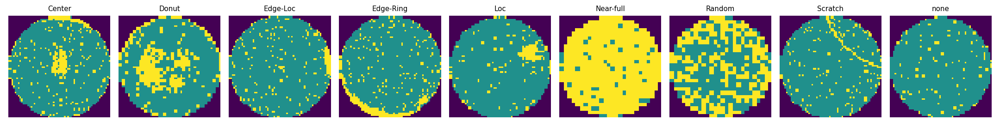
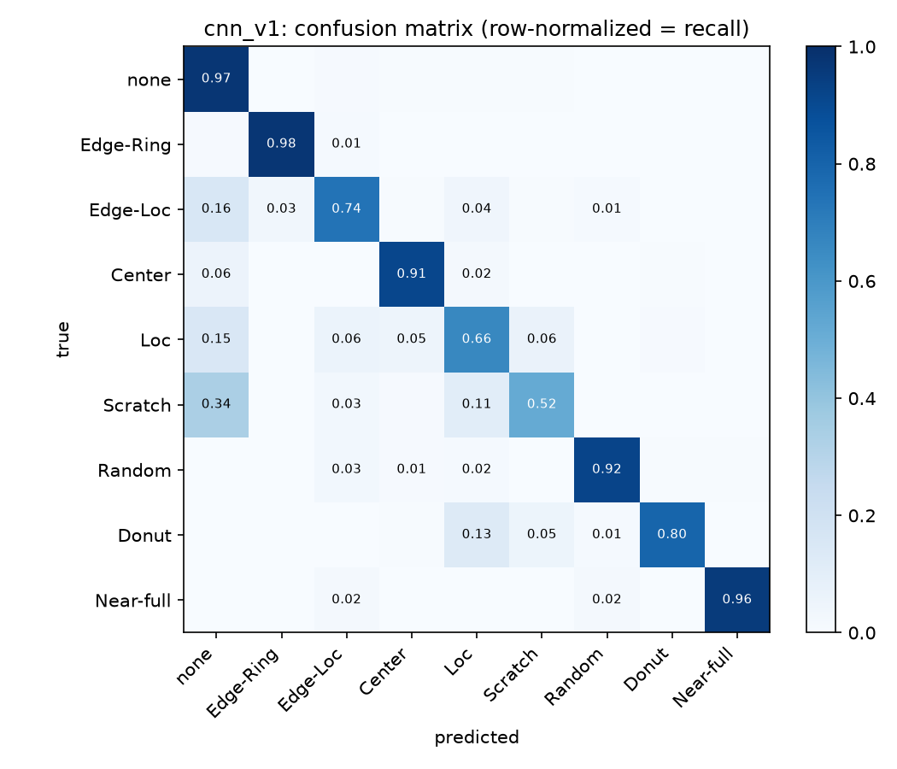
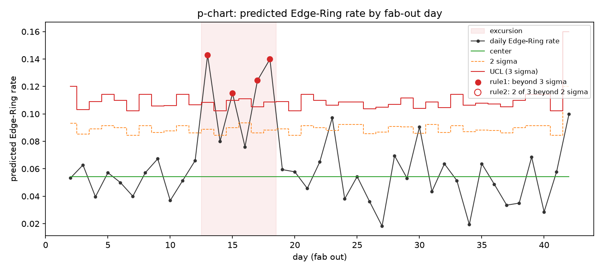
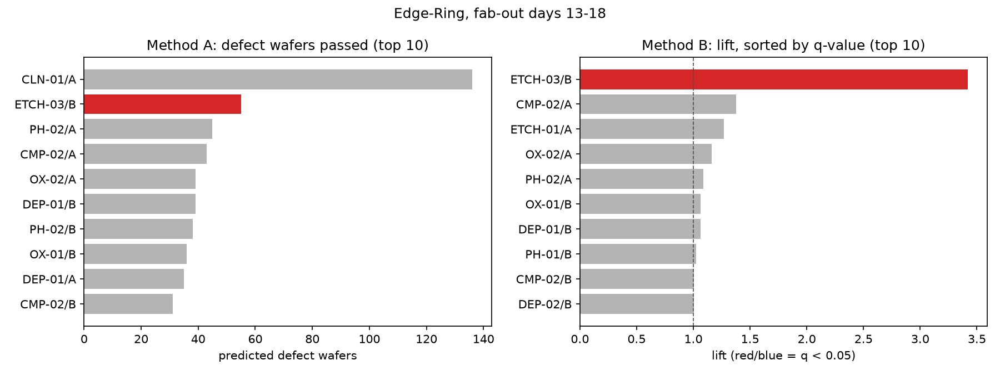
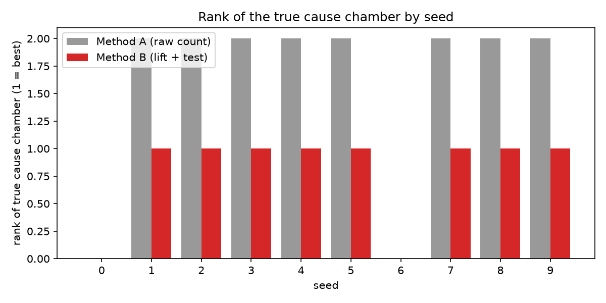
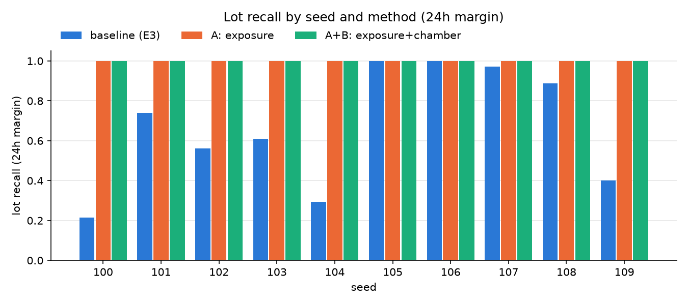

# fabtrace

Wafer defect root-cause analysis and containment on a simulated fab, built on the public WM-811K wafer map dataset.


A customer reports more Edge-Ring failures. fabtrace notices the excursion on a control chart, finds which process chamber the defective wafers have in common, and decides which lots to put on hold, the same flow a quality engineer follows in an 8D investigation.

Because real fab data is not available, a known fault is injected into a simulated fab so that every step can be scored against the ground truth.

#### Current results (held-out seeds, see [E3](results/experiments/20261111-E3.md) and [E4](results/experiments/20261122-E4.md))

- **Wafer map classifier:** macro-F1 **0.80** and Edge-Ring recall **0.976** on 51,885 maps never used for training or model selection.
- **Root cause:** whenever the excursion was detected, the statistical method ranked the true chamber **first in 18 of 18** held-out seeds (8 in E3, 10 in E4). In E3, a naive count of defective wafers was fooled by a bottleneck tool in all 8 detected seeds.
- **Containment:** re-estimating the exposure period from the suspect chamber's own control chart raised lot recall from **0.67 to 1.00** on fresh seeds 100 to 109. No seed missed an affected lot (8 of 10 did before), at the cost of **2.1 extra good lots** held per incident.
- **Open issue:** chamber-level monitoring could not be tested on held-out seeds, because the fab-wide chart already caught all 10. On the two seeds E3 missed it found the cause both times, but held up to 14 good lots.

## Repository layout

```
fabtrace/
├── configs/
│   ├── fab.yaml                 # virtual fab: 6 steps, tools, chambers, lot schedule
│   └── scenarios/s1.yaml        # injected fault: ETCH-03/B, days 12-18, Edge-Ring
├── src/fabtrace/
│   ├── data/                    # WM-811K loading, train/val/fab split, training batches
│   ├── sim/                     # lot genealogy, fault injection, generate entry point
│   ├── models/                  # CNN, training loop, evaluation and predictions
│   └── analysis/                # p-chart, chamber monitor, commonality, exposure, containment, pipeline, reports, experiments
├── scripts/                     # data prep, training, evaluation, run_rca, run_e3, run_e4, run_e5
├── notebooks/01_sanity.ipynb    # E1: does the simulation look as intended
├── tests/                       # mirrors src/; runs on CI without the dataset
├── results/
│   ├── experiments/             # hand-written, dated experiment records, never edited afterwards
│   ├── reports/                 # generated by scripts, overwritten on each run
│   ├── figures/
│   └── logs/                    # training logs
└── docs/
    ├── specs/                   # scope and done criteria for each milestone
    └── figures/
```

## Key documents

| Type | Documents |
| --- | --- |
| Specs | [01 virtual fab](docs/specs/01-virtual-fab.md) · [02 classifier](docs/specs/02-wafermap-classifier.md) · [03 commonality and containment](docs/specs/03-commonality-containment.md) · [04 chamber monitoring](docs/specs/04-chamber-monitoring.md) |
| Experiments | [E1 simulation sanity](results/experiments/20261108-E1.md) · [E2 class balancing](results/experiments/20261111-E2.md) · [E3 held-out seeds](results/experiments/20261111-E3.md) · [E5 containment margin](results/experiments/20261122-E5.md) · [E4 chamber-level improvements](results/experiments/20261122-E4.md) |
| Reports | [classifier](results/reports/classifier_report.md) · [S1 root cause, seed 42](results/reports/s1_rca.md) · [E3 per-seed table](results/reports/e3_summary.md) · [E5 summary](results/reports/e5_summary.md) · [E4 summary](results/reports/e4_summary.md) |

Design decisions and their reasoning are recorded in each pull request and, for the larger ones, in issue comments.

## How it works

### 1. Simulated Fab Environment

Real fab data with lot genealogy is confidential, so WM-811K wafer maps are placed onto a simulated fab where the cause is known.

- **Scale:** 8,000 wafers across 320 lots over 40 days
- **Process:** 6 process steps and 26 chambers
- **Lot routing:** Each lot enters one tool per step, and its wafers are split across that tool's chambers.
- **Deliberate confounder:** One cleaning tool processes every wafer, creating a trap for naive analysis.

### 2. Injected Defect Scenario (S1)

The simulation introduces a known chamber-level defect to evaluate whether the analysis can identify its root cause.

- **Suspect chamber:** ETCH-03/B
- **Defect pattern:** Edge-Ring
- **Exposure period:** Days 12–18
- **Injected behavior:** Wafers etched in ETCH-03/B during this period develop Edge-Ring defects.
- **Background noise:** All other wafers follow the natural WM-811K class distribution, where approximately 5% are Edge-Ring without any process-related cause.

### 3. Analysis Pipeline

The analysis runs in four steps, using only classifier predictions rather than ground-truth labels.

#### Step 1. Wafer Map Classification

- Classify each wafer map using a lightweight CNN (`cnn_v1`, approximately 100K parameters).
- The virtual fab uses maps from a 30% split that the classifier never sees during training.

#### Step 2. Defect Monitoring

Monitor each defect pattern using a p-chart grouped by fab-out day.

- Control limits are calculated using exact binomial quantiles.
- A 2-of-3 beyond 2 sigma rule detects gradual but sustained increases.

Optionally (`--method exposure+chamber`), also monitor every chamber separately, by the day wafers passed it, because a fab-wide chart dilutes a single chamber's signal.

- About 8,000 chamber x pattern x day points are watched at once, so the tail probability is set so that a run raises at most 0.5 false alarms on average.
- An alarm is never a cause by itself. Its wafers' fab-out days become an analysis window for step 3, and the alarm is accepted only if the alarmed chamber ranks first and is significant there.

#### Step 3. Root Cause Identification

Identify the common cause among wafers in the excursion window.

- Compare each chamber's defect rate against the rest of its process step using lift.
- Apply a one-sided Fisher's exact test.
- Correct for multiple comparisons using the Benjamini-Hochberg procedure.

#### Step 4. Lot Containment

- Trace every lot that passed through the suspect chamber during the exposure period.
- A 24-hour margin is added to the exposure window because the cost of shipping a defective lot is higher than that of re-inspecting a good one. [E5](results/experiments/20261122-E5.md) checked whether a shorter margin would do and kept 24 hours.

By default (`--method baseline`), the exposure period is when the wafers in the excursion window passed the suspect chamber. With `--method exposure` or `exposure+chamber`, it is re-estimated from the suspect chamber's own p-chart over the whole 40 days, so it is not cut short when the fab-wide chart only catches the peak days.

### 4. Validation

A test verifies that shuffling the ground-truth columns leaves the analysis output unchanged, ensuring that the pipeline relies exclusively on classifier predictions rather than hidden labels.

### 5. WM-811K Dataset

<details>
<summary>WM-811K class distribution and sample maps</summary>

172,950 labeled maps, downsized to 64x64 with values 0 (outside wafer), 1 (good die), 2 (defective die).

| Class | Count |
| --- | --- |
| none | 147,431 |
| Edge-Ring | 9,680 |
| Edge-Loc | 5,189 |
| Center | 4,294 |
| Loc | 3,593 |
| Scratch | 1,193 |
| Random | 866 |
| Donut | 555 |
| Near-full | 149 |

`none` accounts for 85% of labeled maps, so macro-F1 is used as the main metric instead of accuracy.


</details>

## Results

### 1. Classifier

[Report](results/reports/classifier_report.md) · [E2](results/experiments/20261111-E2.md)

- **Evaluation set:** 51,885 maps never used for training or model selection.
- **Class balancing matters:** without it, the model never predicts Scratch at all.

| Model | Class balancing | macro-F1 | Edge-Ring recall | Scratch recall |
| --- | --- | --- | --- | --- |
| `cnn_v1` | yes | **0.802** | **0.976** | **0.52** |
| `cnn_v1_nobalance` | no | 0.743 | 0.947 | 0.00 |



### 2. Root Cause on the Development Seed (42)

[Report](results/reports/s1_rca.md)

- **Excursion:** only the Edge-Ring chart raised an excursion (fab-out days 13 to 18).
- **Analysis window:** 1,201 wafers in that window.

| Method | Rank 1 | True chamber ETCH-03/B |
| --- | --- | --- |
| A: count of defective wafers passed | CLN-01/A (bottleneck, all wafers) | rank 2 |
| B: lift + Fisher + BH | ETCH-03/B, lift 3.42, q < 0.0001 | **rank 1, the only significant chamber** |

#### Key observations

- **Multiple testing correction prevents a false cause:** the runner-up CMP-02/A had p = 0.009 and would have been named a cause without correction (q = 0.11).
- **Raw counts are misleading:** over the whole 40 days the true chamber ranks only 17th of 26 by raw count, because ETCH chambers each handle 11% of wafers while other chambers handle 25% ([E1](results/experiments/20261108-E1.md)).





### 3. Held-out Seeds (0 to 9)

[Summary](results/reports/e3_summary.md) · [E3](results/experiments/20261111-E3.md)

Seed 42 was used to tune rules and margins, so performance is measured on new seeds 0 to 9.

| Stage | Result |
| --- | --- |
| Excursion detected | 8/10 (7/10 with the 3-sigma rule alone) |
| True chamber ranked first, when detected | 8/8 |
| Bottleneck ranked first by naive count, when detected | 8/8 |
| Lot recall with 24h margin, detected seeds | 0.79 on average |
| Wrongly named chambers | 1 in total |



#### What the held-out seeds revealed

- **Seed 42 was lucky:** it had a long excursion window, which the held-out seeds mostly do not.
- **Diluted signal:** a fab-wide chart dilutes a single chamber's signal.
- **Short exposure period:** the exposure period taken from the chart's peak days is too short.
- **Next step:** both were addressed in [spec 04](docs/specs/04-chamber-monitoring.md) and evaluated on fresh seeds 100 to 109 (below).

### 4. Chamber-level Improvements on Fresh Seeds (100 to 109)

[Summary](results/reports/e4_summary.md) · [E4](results/experiments/20261122-E4.md)

Seeds 0 to 9 were used to decide what to improve, so the improvements are measured on new seeds 100 to 109. Each seed's fab and predictions are shared by all three methods. Pass criteria were fixed before the run.

| Method | Detected | True chamber first | Lot recall (24h) | Seeds missing lots | Extra good lots held | Wrongly named chambers |
| --- | --- | --- | --- | --- | --- | --- |
| Baseline (E3) | 10/10 | 10/10 | 0.668 | 8 | 1.8 | 0 |
| Exposure re-estimation | 10/10 | 10/10 | **1.000** | **0** | 3.9 | 0 |
| + chamber monitoring | 10/10 | 10/10 | **1.000** | **0** | 3.9 | 0 |



#### What changed

- **Short exposure periods are fixed:** on seeds 100 and 109 the fab-wide chart caught only two edge days of the excursion, and baseline lot recall was 0.21 and 0.40. The re-estimated exposure period recovered every affected lot.
- **The cost is within what the margin already accepts:** 2.1 extra good lots per incident, against a criterion of 3 (about one day of lots through the suspect tool, the amount the 24-hour margin already accepts).
- **Chamber monitoring was not needed here:** the fab-wide chart caught all 10 seeds, so none of the 27 chamber alarms was confirmed as a new cause, and none named a wrong chamber.
- **On the seeds E3 missed (0 and 6, not held-out):** chamber monitoring found the true chamber both times with lot recall 1.0, but held 4 and 14 good lots. Its analysis window spans the fab-out days of every wafer that passed the chamber on alarm days, which widens the exposure period.

## Quick start

Requires [uv](https://docs.astral.sh/uv/). Runs on CPU.

### 1. Prepare the Data

The original `LSWMD.pkl` is a Python 2 pickle that needs a lot of memory, so it is converted once on Kaggle and only the compact output is used locally.

- Open a Kaggle notebook, add the WM-811K dataset as input, and run `scripts/prepare_wm811k.py` ([notebook](https://www.kaggle.com/code/haye0njung/wm-811k-preprocessing)).
- Download `wm811k_labeled_64.npz` and `wm811k_labeled_64.parquet` into `data/interim/`.

```bash
uv sync
uv run python scripts/check_data.py
```

### 2. Generate the Simulated Fab

- **Output:** `genealogy.parquet`, `wafers.parquet`, and `ground_truth.json` in `data/processed/`.
- **Reproducible:** the same seed always produces the same data.

```bash
uv run python -m fabtrace.sim.generate --scenario configs/scenarios/s1.yaml --seed 42
```

### 3. Train and Evaluate the Classifier

- **Training time:** about 10 minutes per model on an 8-thread CPU.
- **Skip training:** pretrained weights are attached to the GitHub release `v0.2-classifier`. Place them in `models/` and run `scripts/evaluate_classifier.py` to reproduce the report.

```bash
uv run python scripts/train_classifier.py --seed 42
uv run python scripts/train_classifier.py --seed 42 --no-balance
```

### 4. Run the Root Cause Analysis

- `run_rca.py` analyzes one seed and writes `results/reports/s1_rca.md`. `--method` picks the containment method (`baseline`, `exposure`, `exposure+chamber`).
- `run_e3.py` runs held-out seeds 0 to 9 with the baseline method (about 5 minutes).
- `run_e4.py` runs fresh seeds 100 to 109 with all three methods.

```bash
uv run python scripts/run_rca.py --scenario s1 --seed 42
uv run python scripts/run_rca.py --scenario s1 --seed 42 --method exposure+chamber
uv run python scripts/run_e3.py
uv run python scripts/run_e4.py
```

### Tests

CI runs the same tests on every pull request; tests that need the real dataset are skipped there.

```bash
uv run pytest
```

## Limitations

### Data

- **Synthetic genealogy:** wafer maps are real, but lot history and fault timing are simulated. A real fab would score against engineer-confirmed root causes instead.
- **Downsized maps:** maps are reduced to 64x64, which makes small local defects (Loc, Scratch) harder to separate from normal wafers.

### Evaluation and Method

- **One scenario:** only S1 (a single chamber, one pattern) is evaluated so far. Two simultaneous causes would hide the second one, because a chamber alarm is accepted only when its chamber ranks first.
- **Chamber monitoring is untested on held-out seeds:** its detection benefit is shown only on synthetic predictions and on seeds 0 and 6, which were used for development.
- **Over-holding:** the re-estimated exposure period is never shorter than the baseline one, so a baseline period that ends too late, or a long window from a chamber alarm, carries extra good lots (up to 14 on seed 6).
- **Edge days:** an affected lot whose wafers happen to show few defects on the first or last day of the excursion can be missed even with the 24-hour margin ([E5](results/experiments/20261122-E5.md)).
- **Shared baseline rate:** chamber monitoring assumes every chamber has the fab-wide normal rate for each pattern, which holds in the simulation but not necessarily in a real fab.
- **Retrospective monitoring:** defects are known only after fab-out and classification, so containment works on lots already past the suspect chamber.
