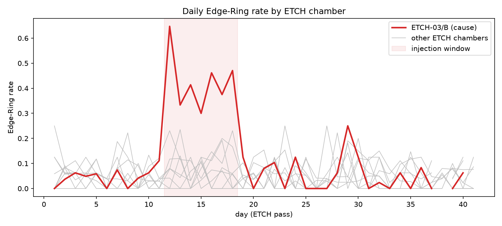
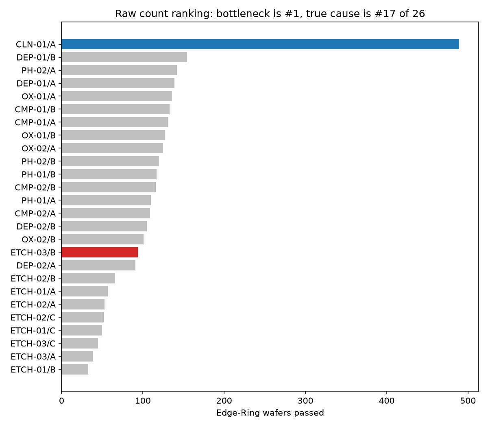

# E1. 가상 팹 sanity 확인

## 가설

1. 주입 기간(12~18일차)에 ETCH-03/B를 지난 웨이퍼의 Edge-Ring 비율이 다른 ETCH 챔버보다 뚜렷이 높다.
2. Edge-Ring 웨이퍼 경유 횟수로 챔버를 줄 세우면 1위는 공통 병목 CLN-01/A다.
3. 같은 순위에서 원인 챔버 ETCH-03/B는 상위권에 오르지 못한다. ETCH 챔버 하나가 처리하는 웨이퍼 비율이 다른 단계 챔버보다 작기 때문이다.

## 조건

| 항목 | 값 |
| --- | --- |
| 시나리오 | S1 (`configs/scenarios/s1.yaml`) |
| 시드 | 42 |
| 관련 커밋 | `<git rev-parse --short HEAD 결과>` |
| 데이터 확인 | check_data.py 전 항목 OK |
| 노트북 또는 스크립트 | `notebooks/01_sanity.ipynb` |
| 관련 이슈 | #5 |

## 방법

- 그림 1: ETCH 통과 날짜 기준, 챔버별 하루 Edge-Ring 비율. 주입 기간을 음영으로 표시한다.
- 그림 2: 챔버별 Edge-Ring 웨이퍼 경유 횟수 순위. 원인 챔버와 병목 챔버를 색으로 구분한다.
- 시뮬레이션 자체를 검사하는 실험이므로 정답 컬럼 `true_pattern`을 사용한다.

## 결과

| 구간 | 웨이퍼 | Edge-Ring 비율 |
| --- | --- | --- |
| ETCH-03/B, 주입 기간 | 159 | 41.5% |
| ETCH-03/B, 그 외 | 590 | 4.7% |
| 다른 ETCH 챔버, 주입 기간 | 1,242 | 7.1% |
| 다른 ETCH 챔버, 그 외 | 6,009 | 5.1% |

| 항목 | 값 |
| --- | --- |
| 단순 집계 1위 | CLN-01/A (489장) |
| 원인 ETCH-03/B 순위 | 26개 챔버 중 17위 |
| 챔버당 처리 비율, ETCH | 11.1% |
| 챔버당 처리 비율, 다른 단계 | 25.0% |
| 챔버당 처리 비율, CLEAN | 100.0% |

| 가설 | 판정 |
| --- | --- |
| 1. 주입 기간에 원인 챔버만 뚜렷이 높다 | 지지 |
| 2. 단순 집계 1위는 병목 설비다 | 지지 |
| 3. 원인 챔버는 단순 집계 상위권에 오르지 못한다 | 지지 |

#### ETCH 챔버별 하루 Edge-Ring 비율

#### 챔버별 Edge-Ring 웨이퍼 경유 횟수 순위

## 해석

- 주입한 결함은 의도대로 나타났다. ETCH-03/B의 Edge-Ring 비율이 주입 기간에만 약 9배로 오르고, 기간이 끝나자 평상시 수준으로 돌아왔다.
- 단순 집계는 원인이 아니라 처리량을 잰다. 모든 웨이퍼가 거치는 CLN-01/A가 1위이고, 처리 비율이 25%인 챔버들이 11.1%인 ETCH 챔버보다 위에 온다.
- 하루 단위 비율은 잡음이 크다. 챔버 하나가 하루 20장 남짓을 처리해 몇 장만 몰려도 비율이 크게 흔들린다. 원인이 아닌 ETCH 챔버도 하루 20%를 넘는 날이 있고, ETCH-03/B도 주입 기간이 아닌 29일차에 약 25%까지 올랐다.
- 다른 ETCH 챔버의 주입 기간 비율(7.1%)이 평상시(5.1%)보다 조금 높은 것도 이런 우연의 범위로 본다. 결함 주입은 ETCH-03/B를 지난 웨이퍼에만 적용되도록 코드와 테스트로 확인되어 있다.

## 다음 조치

- 03의 방법 B는 경유 횟수가 아니라 처리량 대비 농축도(lift)로 순위를 매긴다.
- 챔버 26개를 동시에 검정하므로 Benjamini-Hochberg 보정을 건다. 그림만 보고 튀는 챔버를 고르면 29일차 같은 우연에 속는다.
- 하루 단위가 아니라 기간 단위로 묶어 검정하고, p 관리도는 표본 크기에 따라 관리한계가 달라지는 방식으로 그린다.