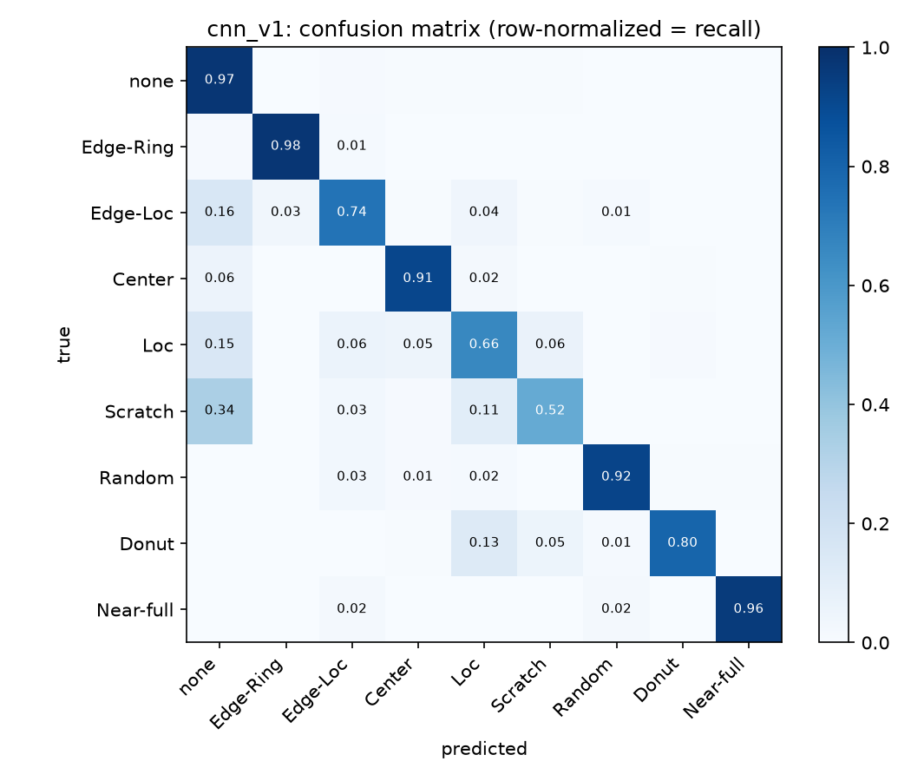
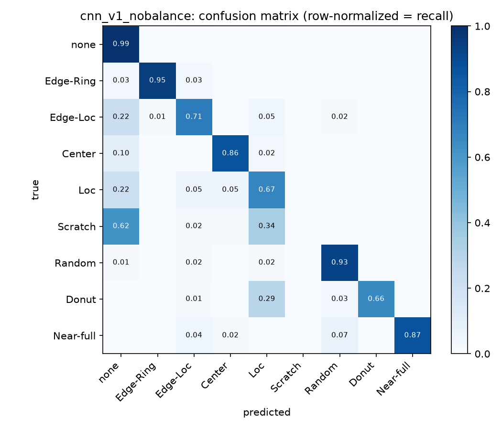
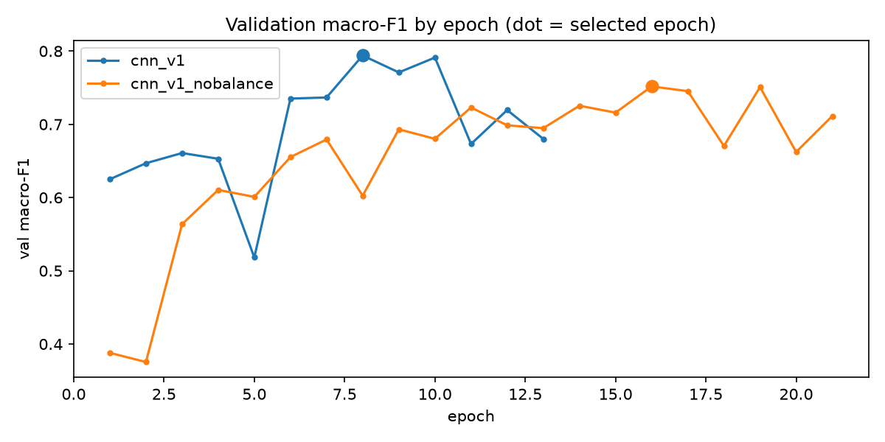

# E2. 불균형 대응 효과 확인

## 가설

1. none 샘플링과 빈도 역수 제곱근 가중치를 쓴 모델이, 같은 에폭당 장수로 무작위 학습한 모델보다 fab 몫 macro-F1이 높다.
2. 차이는 소수 클래스(Scratch, Random, Donut, Near-full) recall에서 크게 나타난다.
3. 03에 직결되는 Edge-Ring recall은 두 모델 모두 높고, 불균형 대응 모델이 같거나 높다.

## 조건

| 항목 | 값 |
| --- | --- |
| 시나리오 | 해당 없음 (분류기 실험) |
| 시드 | 42 (학습) |
| 관련 커밋 | `<git rev-parse --short HEAD 결과>` |
| 데이터 확인 | check_data.py 전 항목 OK |
| 노트북 또는 스크립트 | `scripts/train_classifier.py`, `scripts/evaluate_classifier.py` |
| 관련 이슈 | #15, #16 |
| 모델 파일 | GitHub Release `v0.2-classifier` |

## 방법

- 두 모델(`cnn_v1`, `cnn_v1_nobalance`)을 같은 시드와 같은 에폭당 장수(25,311장)로 학습했다. 비교 모델은 train 몫에서 무작위로 뽑고 클래스 가중치를 쓰지 않았다.
- 모델 선택은 val 몫 macro-F1로 했고, fab 몫 51,885장 전체로 평가했다.
- `results/reports/classifier_report.md`의 요약 표와 혼동행렬을 비교했다.

## 결과

| 모델 | val macro-F1 | fab macro-F1 | fab Edge-Ring recall |
| --- | --- | --- | --- |
| `cnn_v1` (불균형 대응) | 0.7940 | 0.8017 | 0.9756 |
| `cnn_v1_nobalance` | 0.7517 | 0.7432 | 0.9470 |

클래스별 recall (혼동행렬 대각선, 소수점 둘째 자리)

| 클래스 | `cnn_v1` | `cnn_v1_nobalance` | 차이 |
| --- | --- | --- | --- |
| none | 0.97 | 0.99 | -0.02 |
| Edge-Ring | 0.98 | 0.95 | +0.03 |
| Edge-Loc | 0.74 | 0.71 | +0.03 |
| Center | 0.91 | 0.86 | +0.05 |
| Loc | 0.66 | 0.67 | -0.01 |
| Scratch | 0.52 | 0.00 | +0.52 |
| Random | 0.92 | 0.93 | -0.01 |
| Donut | 0.80 | 0.66 | +0.14 |
| Near-full | 0.96 | 0.87 | +0.09 |

| 가설 | 판정 |
| --- | --- |
| 1. 불균형 대응 모델의 macro-F1이 높다 | 지지 (+5.9%p) |
| 2. 차이는 소수 클래스에서 크다 | 부분 지지. Scratch, Donut, Near-full은 크게 올랐고 Random은 차이가 없다 |
| 3. Edge-Ring recall은 둘 다 높고 불균형 대응 모델이 같거나 높다 | 지지 (0.976 대 0.947) |

## 해석

- 불균형 대응의 효과는 대부분 Scratch에서 나왔다. 비교 모델은 Scratch를 한 장도 Scratch로 예측하지 않았고(62%를 none, 34%를 Loc으로 판정), 불균형 대응 모델은 절반을 맞혔다. 학습 데이터에서 Scratch는 716장으로, 가중치 없이는 모델이 이 클래스를 포기하는 쪽이 손실 면에서 이득이었던 것으로 본다.
- Random은 소수 클래스인데도 두 모델이 비슷하다. 웨이퍼 전체에 불량이 흩어지는 뚜렷한 모양이라 데이터가 적어도 구분이 쉬운 패턴으로 본다.
- 대가도 있다. 불균형 대응 모델은 none recall이 2%p 낮아, none 일부를 불량으로 판정한다. 가상 팹 8,000장 중 none이 약 85%이므로 수십에서 백여 장 규모의 오탐이 여러 클래스에 흩어진다.
- 두 모델 모두 Loc, Scratch, Edge-Loc의 상당수를 none으로 판정한다. 다이 몇 개 규모의 작은 국소 불량은 64x64로 줄이면 정상과 구분이 어려워지는 것으로 본다.
- val과 fab의 macro-F1 차이(4.2%p, 5.9%p)가 같은 방향이고 fab 쪽이 더 커서, val의 출렁임 때문에 생긴 차이는 아니다.

## 다음 조치

- 03의 예측 모델은 `cnn_v1`을 쓴다. Edge-Ring recall이 0.976이라 원인 챔버에 몰린 불량을 놓칠 가능성이 낮다.
- none 오탐이 Edge-Ring으로 얼마나 들어오는지 리포트의 Edge-Ring precision으로 확인하고, 03의 공통성 분석에서 잡음으로 작동하는지 본다. 필요하면 저장해둔 클래스 확률로 신뢰도 임계값을 건다.
- val macro-F1의 출렁임을 줄이는 학습률 스케줄러, 특징 기반 모델과의 비교는 03 완료 후 시간이 남으면 진행한다.
