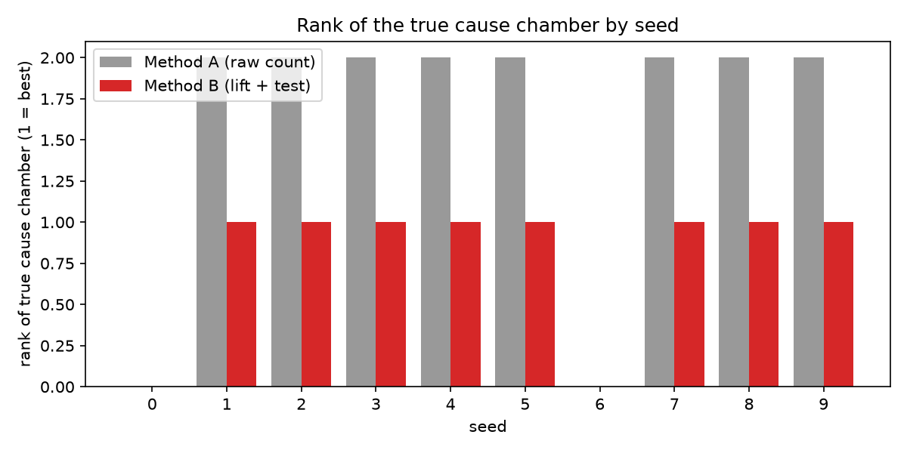

# E3. 시드 10개 반복 평가

## 가설

1. 방법 B는 시드 10개 모두에서 원인 챔버 ETCH-03/B를 1위로 고르고, 방법 A는 병목 CLN-01/A를 1위로 고른다.
2. 여유 24시간 격리는 시드 10개 모두에서 영향 로트를 놓치지 않는다.
3. 일부 시드에서는 rule1만으로 이상 구간을 놓치고, rule2가 이를 보완한다.
4. 다른 패턴 오탐과 잘못 지목한 원인 챔버는 거의 없다.

## 조건

| 항목 | 값 |
| --- | --- |
| 시나리오 | S1 (`configs/scenarios/s1.yaml`) |
| 시드 | 평가 0~9, 참고 42 (개발용, 평가 제외) |
| 관련 커밋 | `<git rev-parse --short HEAD 결과>` |
| 데이터 확인 | check_data.py 전 항목 OK |
| 노트북 또는 스크립트 | `scripts/run_e3.py` |
| 분류기 | `cnn_v1` 고정 (시드마다 재학습하지 않음) |
| 관련 이슈 | #26 |

## 방법

- 시드마다 가상 팹(이력, 맵 배정)을 새로 만들고 `cnn_v1`로 예측한다.
- `run_analysis`로 감시, 공통성, 격리를 실행하고 정답지로 채점한다.
- 격리는 여유 0, 12, 24시간을 모두 계산하고, 감지는 rule1만 쓸 때와 rule2를 더할 때를 비교한다.

## 결과

| 시드 | 감지 | 방법 A 순위 | 방법 B 순위 | 원인 특정 | 로트 recall (24시간) |
| --- | --- | --- | --- | --- | --- |
| 0 | X | - | - | X | 0.000 |
| 1 | O | 2 | 1 | O | 0.500 |
| 2 | O | 2 | 1 | O | 0.800 |
| 3 | O | 2 | 1 | O | 0.909 |
| 4 | O | 2 | 1 | O | 1.000 |
| 5 | O | 2 | 1 | O | 0.875 |
| 6 | X | - | - | X | 0.000 |
| 7 | O | 2 | 1 | O | 0.931 |
| 8 | O | 2 | 1 | O | 0.750 |
| 9 | O | 2 | 1 | O | 0.533 |
| 42 (참고) | O | 2 | 1 | O | 1.000 |

| 항목 | 값 |
| --- | --- |
| 감지 | 8/10 |
| 감지, rule1만 | 7/10 |
| rule2가 더 잡은 날이 있는 시드 | 7/10 |
| 감지된 시드에서 방법 B 1위 | 8/8 |
| 감지된 시드에서 방법 A 1위가 병목 | 8/8 |
| 잘못 지목한 원인 챔버 (합계) | 1 |
| 다른 패턴 오탐 구간 (합계) | 4 |

| 여유 | 로트 precision 평균 | 로트 recall 평균 | 로트 recall, 감지된 8개 평균 | 로트를 놓친 시드 |
| --- | --- | --- | --- | --- |
| 0시간 | 0.795 | 0.538 | 0.673 | 10/10 |
| 12시간 | 0.779 | 0.581 | 0.726 | 9/10 |
| 24시간 | 0.739 | 0.630 | 0.787 | 9/10 |

| 가설 | 판정 |
| --- | --- |
| 1. 방법 B 10/10 원인 1위, 방법 A는 병목 1위 | 부분 지지. 감지된 8개 시드에서는 8/8 모두 맞았지만, 2개 시드는 감지 단계에서 놓쳤다 |
| 2. 24시간 격리는 로트를 놓치지 않는다 | 기각. 9/10 시드에서 놓쳤고, 감지된 시드만 봐도 recall 평균 0.787 |
| 3. rule2가 rule1을 보완한다 | 지지. rule1만으로는 7/10, rule2를 더해 8/10 |
| 4. 오탐과 잘못된 원인이 거의 없다 | 지지. 70번의 패턴 감시(10시드 x 7패턴)에서 오탐 구간 4개, 잘못된 원인 1개 |

## 해석

- 공통성 분석(방법 B)은 확실히 작동한다. 이상 구간만 주어지면 8/8 모두 원인 챔버를 1위로, 대부분 유일한 유의 후보로 찾았다. 방법 A는 매번 병목에 속았고 원인은 매번 2위였다.
- 약점은 앞뒤 단계에 있다. 공장 전체 웨이퍼로 그린 관리도는 챔버 하나의 이상을 묽게 만든다. 원인 챔버는 하루 200장 중 20장 남짓만 처리해서, 그 안의 불량률이 40%여도 전체 비율은 5%에서 9% 정도로만 오른다.
- 감지 실패(seed 0, 6)는 원래 신호가 약한 시드에서 일어났다. 정답 패턴을 대신 넣었을 때는 이 두 시드도 하루이틀 감지됐으나, 분류기 오차(none을 불량으로 보는 오탐 등, E2 참고)가 더해지면서 경계의 신호가 사라졌다.
- 격리 recall이 낮은 이유도 같다. 관리도는 불량이 몰린 정점 며칠만 이상 구간으로 잡고, 노출 기간을 그 구간 웨이퍼의 통과 시각으로 정하니 실제 7일보다 짧게 잘린다. 여유 시간을 늘려도 recall이 0.67에서 0.79로만 오른다. 여유 시간이 아니라 노출 기간 추정 방식의 문제다.
- seed 42는 이상 구간이 13~18일차로 길게 잡힌 운 좋은 시드였다. 여유 시간과 노출 기간 방식을 seed 42를 보며 정했기 때문에 이 약점이 개발 중에 드러나지 않았다. 개발 시드와 평가 시드를 나눈 덕분에 찾았다.

## 다음 조치

- 개선 A: 원인 챔버를 찾은 뒤, 그 챔버를 지난 웨이퍼만의 일별 불량률을 40일 전체에서 다시 보고 노출 기간을 재추정한다.
- 개선 B: 감시를 공장 전체 외에 챔버 단위(통과 날짜 기준)로도 해서, 묽어진 신호를 잡는다. 챔버 26개와 패턴 8개를 함께 감시하므로 오탐 관리를 설계한다.
- 개선 후 평가는 새 시드 100~109로 한다(E4). 시드 0~9 결과를 보고 고친 방법을 0~9로 다시 재면 성능이 부풀려진다.
