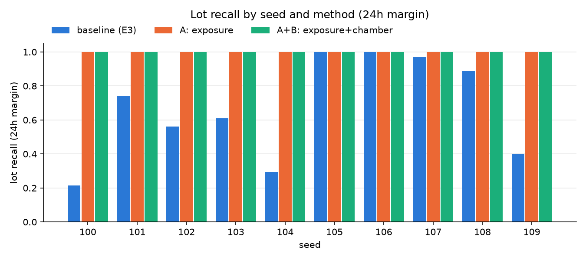

# E4. 챔버 단위 개선 효과 확인

## 가설

1. 개선 방법(A + B)의 감지율이 기존 방법보다 높다.
2. 개선 방법은 감지된 시드에서 로트 recall이 기존 방법보다 높고, 여유 24시간에서 놓치는 로트가 거의 없다.
3. 개선 방법이 추가로 보류하는 정상 로트는 적다.
4. 챔버 감시를 더해도 잘못 지목한 원인 챔버는 늘지 않는다.

## 조건

| 항목 | 값 |
| --- | --- |
| 시나리오 | S1    (`configs/scenarios/s1.yaml`) |
| 시드 | 평가 100~109    (0~9는 E3에서 개선 방향을 정하는 데 썼고, 42는 개발용이라 제외) |
| 방법 | `baseline`,   `exposure`(A),   `exposure+chamber`(A+B),    여유 24시간 |
| 관련 커밋 | `<git rev-parse --short HEAD 결과>`  |
| 데이터 확인 | `<check_data.py 결과>` |
| 노트북 또는 스크립트 | `scripts/run_e4.py` |
| 분류기 | `cnn_v1` 고정    (시드마다 재학습하지 않음) |
| 관련 이슈 | #37 |

## 방법

- 시드마다 가상 팹과 `cnn_v1` 예측을 한 번만 만들고 세 방법을 모두 적용한다.
- E3와 같은 지표(감지, 원인 순위, 격리 precision과 recall, 오탐)에 E4 지표를 더한다.
  - 잘못 지목한 원인: 모든 Finding(모든 패턴, 챔버 감시 포함)에서 센다.
  - 추가 보류 정상 로트: 보류 로트 수에서 찾은 영향 로트 수를 뺀다.
  - 챔버 감시 알림 수와 처리 상태.
- 판정 기준은 실행 전에 정했다(스펙 04 E4, `experiment.judge_e4`). baseline 대 A+B, 여유 24시간.

| 가설 | 지지 조건 |
| --- | --- |
| 1 | A+B의 감지 시드 수가 baseline보다 많다. 둘 다 10/10이면 판정 불가 |
| 2 | 감지된 시드의 lot recall 평균이 baseline보다 높고, A+B에서 로트를 놓친 시드가 1개 이하 |
| 3 | 두 방법 모두 감지한 시드에서 A+B가 추가로 보류한 정상 로트가 사건당 평균 3개 이하 |
| 4 | 잘못 지목한 원인의 합계가 A+B ≤ baseline |

#### 가설 2의 "1개 이하": 
업계 원칙은 0이지만, E5에서 분류 오차가 없어도 시드당 약 8%는 경계 날 신호 부족으로 놓쳤다. 0개면 방법이 설계대로 작동해도 지지될 확률이 약 43%, 1개 이하면 약 81%다.
#### 가설 3의 "3개":
공개된 업계 표준 수치는 없다. 여유 24시간으로 이미 받아들인 비용, 즉 원인 챔버의 하루치 로트(약 2.7개)를 기준으로 삼았다.

## 결과

### 방법별 요약

| method | seeds | detected | cause_found | top1_b | lot_recall_24h_detected | lot_recall_24h_all | lot_precision_24h_detected | seeds_missing_lots_24h | extra_lots_24h_detected | wrong_causes_all | false_causes_first | other_pattern_alarms | chamber_alarms | alarms_confirmed |
| --- | --- | --- | --- | --- | --- | --- | --- | --- | --- | --- | --- | --- | --- | --- |
| baseline | 10 | 10 | 10 | 10 | 0.668 | 0.668 | 0.854 | 8 | 1.800 | 0 | 0 | 2 | 0 | 0 |
| exposure | 10 | 10 | 10 | 10 | 1.000 | 1.000 | 0.824 | 0 | 3.900 | 0 | 0 | 2 | 0 | 0 |
| exposure+chamber | 10 | 10 | 10 | 10 | 1.000 | 1.000 | 0.824 | 0 | 3.900 | 0 | 0 | 2 | 27 | 0 |

### 시드별 요약

| seed | method | detected | window | rank_b | cause_found | wrong_causes_all | lot_recall_24h | lot_precision_24h | extra_lots_24h | chamber_alarms | alarms_confirmed |
| --- | --- | --- | --- | --- | --- | --- | --- | --- | --- | --- | --- |
| 100 | baseline | True | 12-13 | 1 | True | 0 | 0.214 | 0.600 | 2 | 0 | 0 |
| 100 | exposure | True | 12-13 | 1 | True | 0 | 1.000 | 0.737 | 5 | 0 | 0 |
| 100 | exposure+chamber | True | 12-13 | 1 | True | 0 | 1.000 | 0.737 | 5 | 2 | 0 |
| 101 | baseline | True | 15-18 | 1 | True | 0 | 0.739 | 1.000 | 0 | 0 | 0 |
| 101 | exposure | True | 15-18 | 1 | True | 0 | 1.000 | 0.852 | 4 | 0 | 0 |
| 101 | exposure+chamber | True | 15-18 | 1 | True | 0 | 1.000 | 0.852 | 4 | 2 | 0 |
| 102 | baseline | True | 14-16 | 1 | True | 0 | 0.562 | 1.000 | 0 | 0 | 0 |
| 102 | exposure | True | 14-16 | 1 | True | 0 | 1.000 | 0.889 | 2 | 0 | 0 |
| 102 | exposure+chamber | True | 14-16 | 1 | True | 0 | 1.000 | 0.889 | 2 | 2 | 0 |
| 103 | baseline | True | 17-19 | 1 | True | 0 | 0.609 | 0.824 | 3 | 0 | 0 |
| 103 | exposure | True | 17-19 | 1 | True | 0 | 1.000 | 0.852 | 4 | 0 | 0 |
| 103 | exposure+chamber | True | 17-19 | 1 | True | 0 | 1.000 | 0.852 | 4 | 3 | 0 |
| 104 | baseline | True | 15-16 | 1 | True | 0 | 0.294 | 1.000 | 0 | 0 | 0 |
| 104 | exposure | True | 15-16 | 1 | True | 0 | 1.000 | 0.773 | 5 | 0 | 0 |
| 104 | exposure+chamber | True | 15-16 | 1 | True | 0 | 1.000 | 0.773 | 5 | 4 | 0 |
| 105 | baseline | True | 13-18 | 1 | True | 0 | 1.000 | 0.929 | 2 | 0 | 0 |
| 105 | exposure | True | 13-18 | 1 | True | 0 | 1.000 | 0.867 | 4 | 0 | 0 |
| 105 | exposure+chamber | True | 13-18 | 1 | True | 0 | 1.000 | 0.867 | 4 | 4 | 0 |
| 106 | baseline | True | 13-18 | 1 | True | 0 | 1.000 | 0.875 | 3 | 0 | 0 |
| 106 | exposure | True | 13-18 | 1 | True | 0 | 1.000 | 0.778 | 6 | 0 | 0 |
| 106 | exposure+chamber | True | 13-18 | 1 | True | 0 | 1.000 | 0.778 | 6 | 1 | 0 |
| 107 | baseline | True | 12-18 | 1 | True | 0 | 0.972 | 0.972 | 1 | 0 | 0 |
| 107 | exposure | True | 12-18 | 1 | True | 0 | 1.000 | 0.973 | 1 | 0 | 0 |
| 107 | exposure+chamber | True | 12-18 | 1 | True | 0 | 1.000 | 0.973 | 1 | 4 | 0 |
| 108 | baseline | True | 13-17 | 1 | True | 0 | 0.889 | 0.941 | 1 | 0 | 0 |
| 108 | exposure | True | 13-17 | 1 | True | 0 | 1.000 | 0.900 | 2 | 0 | 0 |
| 108 | exposure+chamber | True | 13-17 | 1 | True | 0 | 1.000 | 0.900 | 2 | 2 | 0 |
| 109 | baseline | True | 18-19 | 1 | True | 0 | 0.400 | 0.400 | 6 | 0 | 0 |
| 109 | exposure | True | 18-19 | 1 | True | 0 | 1.000 | 0.625 | 6 | 0 | 0 |
| 109 | exposure+chamber | True | 18-19 | 1 | True | 0 | 1.000 | 0.625 | 6 | 3 | 0 |

## 해석

- 가설 2가 가장 크게 바뀌었다. baseline은 10개 중 8개 시드에서 로트를 놓쳤고(lot recall 0.668), A+B는 놓친 시드가 없다(1.000). 관리도가 이상 기간의 가장자리 이틀만 잡은 seed 100(팹 아웃 12~13일차)과 seed 109(18~19일차)에서 baseline recall은 0.214와 0.400이었고, A는 둘 다 1.000으로 복원했다. E3에서 찾은 약점(노출 기간이 관리도 정점 며칠로 잘림)을 고쳤다.
- 가설 3의 비용은 사건당 추가 보류 정상 로트 +2.1개(1.8 -> 3.9)로 기준(3개) 안이다. precision으로는 0.854 -> 0.824다.
- seed 109에서 A도 정상 로트 6개를 보류했는데, baseline과 같은 수다. A는 기존 노출 기간과 합집합을 쓰므로(#33), 기존 구간이 실제 노출 기간보다 늦게 끝나면 그 초과분이 남는다. 기존보다 짧아지지 않게 한 규칙의 대가다.
- 가설 1은 판정 불가다. 평가 시드 10개 모두 baseline이 이미 감지해서, 챔버 감시(B)가 감지를 늘리는지 볼 기회가 없었다. B의 알림 27건 중 원인으로 확인된 것은 0건이고, A+B와 A의 결과는 모든 시드에서 같다.
- 가설 4는 지지지만, B가 확인한 알림이 없었으므로 이 평가 시드에서만 성립한다. B의 감지 효과는 합성 데이터(#36, 감지 0.84 -> 1.00)와 아래 참고 실행으로만 보였다.

## 참고: E3에서 놓친 시드 0, 6 (평가 아님)

시드 0, 6은 E3 결과를 보고 개선 방향을 정한 시드라 평가 근거가 아니다. 실제 분류기 예측에서 B가 작동하는지 보기 위해 참고로 돌렸다(`results/reports/e4_ref_e3missed/`).

| seed | baseline / A | A+B | A+B 추가 보류 정상 로트 |
| --- | --- | --- | --- |
| 0 | 감지 못 함 | 감지, 원인 1위, lot recall 1.000 | 4개 (precision 0.789) |
| 6 | 감지 못 함 | 감지, 원인 1위, lot recall 1.000 | 14개 (precision 0.576) |

- B는 공장 전체 관리도가 놓친 두 시드를 모두 찾았고, 잘못 지목한 원인은 없었다.
- seed 6에서 정상 로트를 14개 보류했다. 챔버 감시 Finding의 분석 구간(알림 기간 웨이퍼의 팹 아웃 범위, 12~19일차)이 길어서, 그 구간 웨이퍼 전체로 잡은 기준 구간이 실제 노출 기간보다 넓어지고, A가 기준 구간과의 합집합을 쓰므로(#33) 그 초과분이 남았다. 정식 E4 seed 109의 초과 보류 6개도 같은 원인이다.
- 요약의 가설 판정 표는 평가 시드가 아니므로 쓰지 않는다.

## 다음 조치

- README의 결과와 약점 설명을 E4 결과로 갱신한다(별도 docs 이슈).
- 노출 기간 기준 구간의 초과 보류를 줄인다. 기준 구간을 불량 웨이퍼만으로 잡거나, 챔버 이상 구간이 있으면 합집합을 쓰지 않는 방법을 개발 seed 42와 합성 예측으로 검토하고, 새 평가 시드로 다시 평가한다. 경계 날 규칙(E5 후속 과제)과 함께 다룬다.
- B의 감지 효과를 실제 예측으로 정식 평가하려면, baseline이 놓치는 시드가 충분히 나오도록 새 평가 시드를 더 돌린다.
