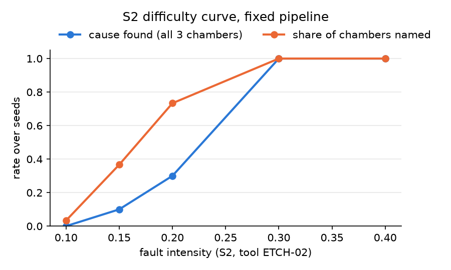

# E6. 고정 파이프라인의 시나리오별 기준선

> 파일 이름을 실행한 날짜로 바꾸고(`YYYYMMDD-E6.md`), `<...>`를 채운 뒤 이 줄을 지우고 커밋한다. 커밋한 뒤에는 고치지 않는다.

## 가설

1. 고정 파이프라인(`exposure+chamber`)은 S1에서 원인을 특정하고 영향 로트를 놓치지 않는다.
2. S2(강도 0.2)에서는 설비의 챔버 일부만 원인으로 지목하거나, 아무것도 지목하지 못한다.
3. S3에서는 두 원인을 모두 지목하지만, 원인과 함께 다니는 챔버도 원인으로 지목한다.
4. S5에서는 원인을 지목하지 않는다.
5. 원인의 영향이 클수록(S2 강도 0.4, S3) 진짜가 아닌 원인을 지목하는 일이 S1보다 많다.
6. S2의 원인 특정률은 강도가 낮아질수록 떨어진다.

## 조건

| 항목 | 값 |
| --- | --- |
| 시나리오 | S1~S5 (`configs/scenarios/`), S2는 강도 0.1, 0.15, 0.2, 0.3, 0.4 |
| 시드 | 개발 200~209 (탐색 500~504는 시나리오 정의에, 평가 300~319는 스펙 06에 씀) |
| 방법 | `exposure+chamber`, 여유 24시간 |
| 채점 | `scoring.score_general` (#48) |
| 관련 커밋 | `<git rev-parse --short HEAD 결과>` (PR 번호) |
| 데이터 확인 | `<check_data.py 결과>` |
| 노트북 또는 스크립트 | `scripts/run_e6.py` |
| 분류기 | `cnn_v1` 고정 |
| 관련 이슈 | #49 |

## 방법

- 시나리오 x 시드마다 가상 팹과 `cnn_v1` 예측을 만들고, 고정 파이프라인을 돌려 일반 채점으로 점수를 낸다.
- 판정 기준은 실행 전에 정했다(스펙 05 E6, `experiment.judge_e6`). 실패가 10개 중 3개 이상에서 나타나야 스펙 06 E7(평가 시드 20개)에서 에이전트가 개선할 여지를 보일 수 있다고 보고 기본선으로 삼았다.

| 가설 | 지지 조건 |
| --- | --- |
| 1 | S1에서 원인을 찾은 시드 10/10, 로트를 놓친 시드 1개 이하 |
| 2 | S2(0.2)에서 원인을 못 찾은 시드 3개 이상 |
| 3 | S3에서 두 원인을 모두 찾은 시드 8개 이상, 진짜가 아닌 원인이 나온 시드 3개 이상 |
| 4 | S5에서 원인을 지목하지 않은 시드 9개 이상 |
| 5 | 시드당 진짜가 아닌 원인 평균이 S2(0.4), S3 모두 S1보다 크다 |
| 6 | S2 원인 특정률이 강도가 낮아질수록 한 번도 오르지 않는다 |

## 결과
### 가설 판정

기준(실행 전에 정함): 실패는 10개 중 3개 이상, S1 로트를 놓친 시드 1개 이하, S3 두 원인 모두 찾음 8개 이상, S5 원인 없음 9개 이상.

| 가설 | 판정 | 근거 |
| --- | --- | --- |
| 1 | 지지 | 원인 찾음 10/10,   로트를 놓친 시드 0 (기준 1 이하) |
| 2 | 지지 | 못 찾은 시드 7/10 (기준 3 이상),   지목한 챔버 비율 평균 0.73 |
| 3 | 지지 | 두 원인 모두 찾음 10/10 (기준 8 이상),   진짜가 아닌 원인이 나온 시드 6 (기준 3 이상) |
| 4 | 지지 | 원인을 지목하지 않은 시드 10/10 (기준 9 이상) |
| 5 | 지지 | 시드당 진짜가 아닌 원인    S1 0.1, S2@0.4 0.9, S3 0.8 |
| 6 | 지지 | 강도별 원인 특정률   0.1: 0.0, 0.15: 0.1, 0.2: 0.3, 0.3: 1.0, 0.4: 1.0 |

### 시나리오별

| 시나리오 | 시드 | 찾은 원인 / 정답 원인 | 원인 precision | 시드당 진짜가 아닌 원인 | lot recall (전체) | 추가 보류 (전체) | 보류 로트 |
| --- | --- | --- | --- | --- | --- | --- | --- |
| S1 | 10 | 10/10 | 0.95 | 0.10 | 1.00 | 5.20 | 23.70 |
| S2@0.1 | 10 | 0/10 | 1.00 | 0.00 | 0.09 | 0.20 | 2.60 |
| S2@0.15 | 10 | 1/10 | 0.96 | 0.10 | 0.49 | 3.70 | 13.90 |
| S2@0.2 | 10 | 3/10 | 0.91 | 0.40 | 0.91 | 10.00 | 27.80 |
| S2@0.3 | 10 | 10/10 | 0.92 | 0.40 | 1.00 | 10.30 | 29.40 |
| S2@0.4 | 10 | 10/10 | 0.81 | 0.90 | 1.00 | 22.40 | 41.50 |
| S3 | 10 | 20/20 | 0.77 | 0.80 | 1.00 | 29.10 | 75.40 |
| S4 | 10 | 10/10 | 0.49 | 1.30 | 0.74 | 15.40 | 60.40 |
| S5 | 10 | 0/0 | - | 0.00 | - | 0.00 | 0.00 |

#### S2 난이도 곡선

## 해석

### 1. 가장 큰 약점: 함께 다니는 챔버를 원인으로 지목

| 시나리오 | 시드당 진짜가 아닌 원인 | 원인 precision | 추가 보류 정상 로트 (전체) |
| --- | --- | --- | --- |
| S1 | 0.1 | 0.95 | 5.2 |
| S2 (강도 0.4) | 0.9 | 0.81 | 22.4 |
| S3 | 0.8 | 0.77 | 29.1 |
| S4 | 1.3 | 0.49 | 15.4 |

- 원인의 영향이 클수록 함께 다니는 챔버가 공통성 분석에서 유의해진다.
- 고정 파이프라인은 유의한 챔버를 모두 원인으로 보므로, 그 챔버의 로트까지 보류한다.

### 2. S4(서서히 오르는 이상)가 가장 나쁘다

- 원인 precision 0.49, lot recall 0.74다.
- 강도가 0에서 시작해 초반 기간이 이상으로 잡히지 않아, 노출 기간이 늦게 시작되는 것으로 보인다.
- 가설에는 넣지 않았던 결과다.

### 3. S2는 강도 0.2~0.3 사이에서 무너진다

| 강도 | 0.4 | 0.3 | 0.2 | 0.15 | 0.1 |
| --- | --- | --- | --- | --- | --- |
| 원인 특정률 | 10/10 | 10/10 | 3/10 | 1/10 | 0/10 |

- 강도 0.2에서 원인을 찾은 시드는 3개지만, lot recall은 0.91이다.
- 로트 하나의 웨이퍼가 설비의 세 챔버로 나뉘어, 챔버 하나만 지목해도 그 로트는 보류된다.
- 챔버 일부 지목은 원인 특정의 실패지만, 로트 단위 격리의 비용은 작다.

### 4. S5는 깨끗하다

- 10개 모두 원인을 지목하지 않았다.
- 스펙 06에서는 에이전트가 원인을 지어내지 않는지 확인하는 시나리오로 쓴다.

### 5. 스펙 06에서 에이전트가 이길 수 있는 지점

| 지점 | 시나리오 | 나타날 점수 |
| --- | --- | --- |
| 함께 다니는 챔버를 원인에서 거르기 | S2 (강도 0.4), S3, S4 | 진짜가 아닌 원인 수, 전체 추가 보류 |
| 서서히 오르는 이상의 노출 시작 앞당기기 | S4 | lot recall |
| 설비 단위 원인 묶기 | S2 (강도 0.15~0.2) | 원인 특정률에 크게, 격리에 작게 |

## 참고: E4 시드 다시 채점 (평가 아님)

E4 시드 100~109를 같은 분류기 예측으로 다시 돌려, E4의 첫 구간 기준과 모든 구간을 합친 기준(#48)으로 채점했다.

| 방법 | 첫 구간 기준 (E4 보고 값) | 모든 구간을 합친 기준 |
| --- | --- | --- |
| baseline | 0.668 | 0.813 |
| exposure+chamber | 1.000 | 1.000 |

- E4는 baseline의 lot recall을 0.145만큼 낮게 잡았다. baseline이 한 원인에 이상 구간을 둘로 나눠 잡은 시드에서 두 번째 구간의 보류를 세지 않았다.
- 개선 방법이 lot recall 1.000을 낸다는 E4 결론은 그대로이고, 개선 폭은 0.668 -> 1.000이 아니라 0.813 -> 1.000이다.
- E4 기록은 고치지 않고 이 절과 README에 정정을 남긴다.

## 다음 조치

- README의 E4 결과(lot recall 0.67 -> 1.00)를 모든 구간을 합친 기준(0.81 -> 1.00)으로 정정하고 이 기록을 가리킨다.
- 스펙 06 E7의 가설과 판정 기준을 이 결과에 맞춰 정한다. 
- 주 지표는 진짜가 아닌 원인 수와 전체 추가 보류, S4의 lot recall이다. S2의 이득은 원인 특정과 격리를 나눠 본다.
