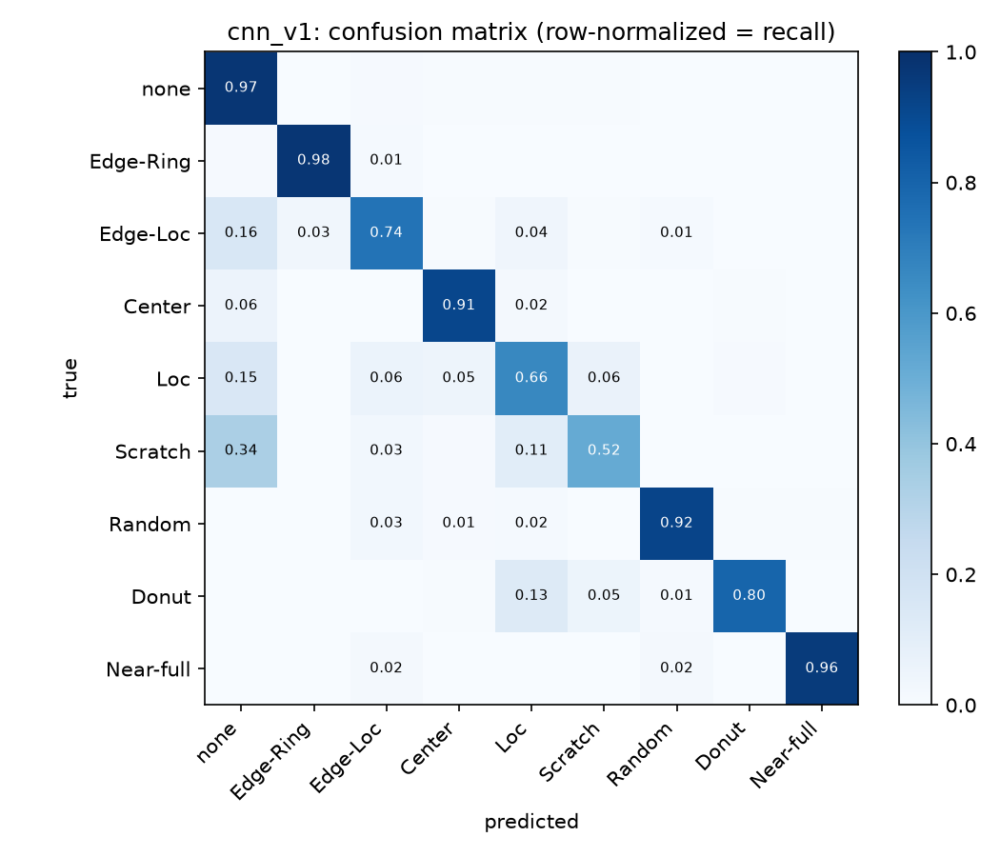
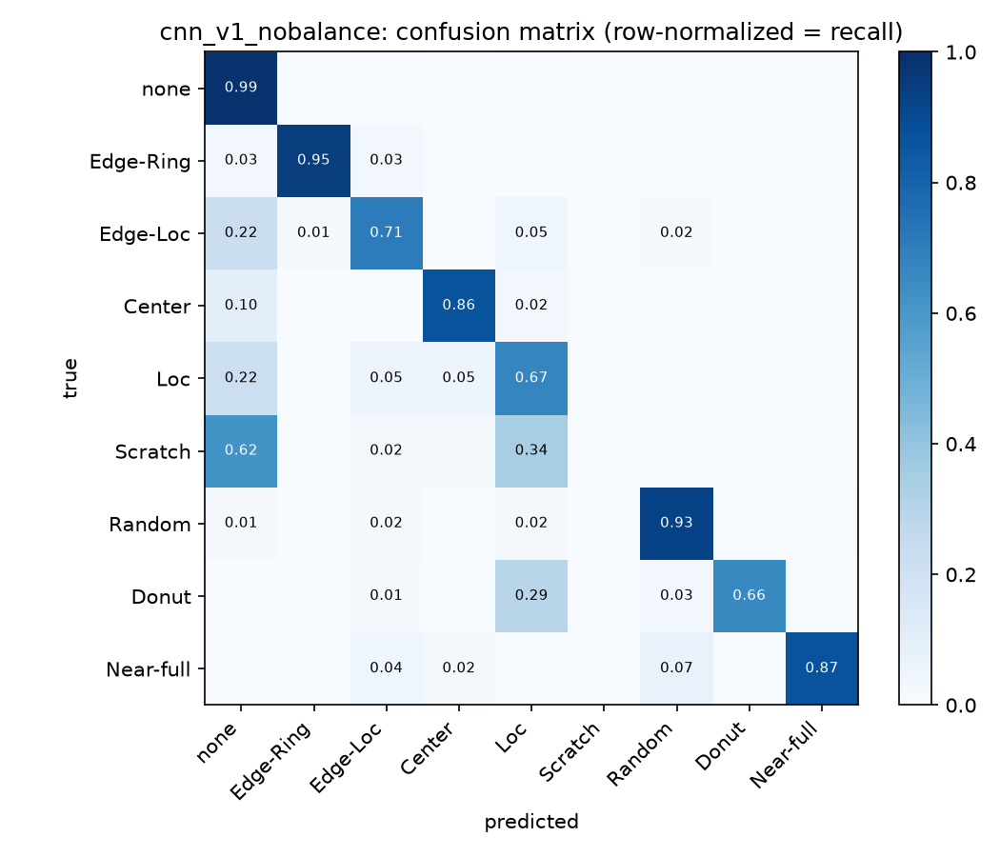
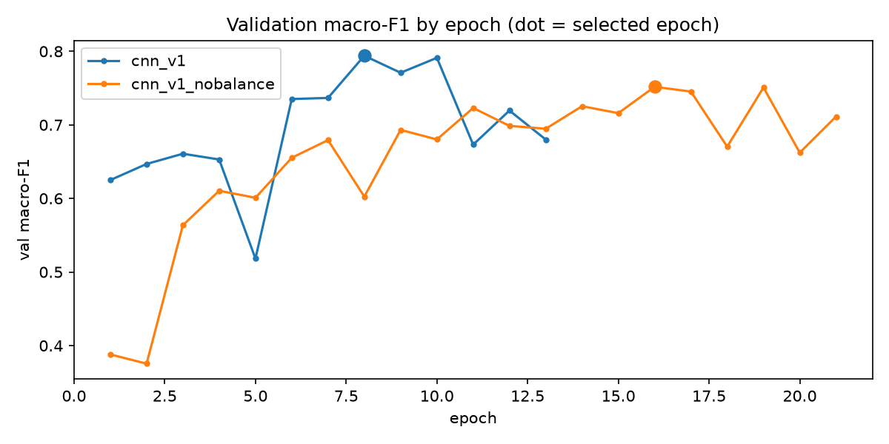

# 웨이퍼 맵 분류기 평가 리포트

> `scripts/evaluate_classifier.py`가 자동 생성한다. 직접 고치지 말 것. 해석은 실험 기록 E2에 있다.

평가 데이터는 fab 몫 51,885장이다. 학습에도, 조기 종료에도 쓰지 않았다.
모델 선택은 val 몫 macro-F1로 했고, fab 몫은 선택 후 확인에만 썼다.

## 모델 요약

| 모델 | 불균형 대응 | 선택 에폭 | val macro-F1 | fab macro-F1 | fab Edge-Ring recall | fab 정확도 |
| --- | --- | --- | --- | --- | --- | --- |
| `cnn_v1` | O | 8 | 0.794 | 0.802 | 0.976 | 0.956 |
| `cnn_v1_nobalance` | X | 16 | 0.752 | 0.743 | 0.947 | 0.961 |

정확도는 메인 지표로 쓰지 않는다. 평가 데이터의 85%가 none이라 none만 맞혀도 정확도가 높게 나온다.

## 클래스별 recall 비교

| 클래스 | 평가 장수 | `cnn_v1` | `cnn_v1_nobalance` |
| --- | --- | --- | --- |
| none | 44,229 | 0.975 | 0.990 |
| Edge-Ring | 2,904 | 0.976 | 0.947 |
| Edge-Loc | 1,557 | 0.741 | 0.706 |
| Center | 1,289 | 0.912 | 0.864 |
| Loc | 1,078 | 0.663 | 0.670 |
| Scratch | 358 | 0.517 | 0.003 |
| Random | 259 | 0.919 | 0.927 |
| Donut | 166 | 0.795 | 0.657 |
| Near-full | 45 | 0.956 | 0.867 |

## `cnn_v1` 클래스별 지표

| 클래스 | precision | recall | F1 |
| --- | --- | --- | --- |
| none | 0.986 | 0.975 | 0.980 |
| Edge-Ring | 0.958 | 0.976 | 0.967 |
| Edge-Loc | 0.707 | 0.741 | 0.724 |
| Center | 0.820 | 0.912 | 0.863 |
| Loc | 0.634 | 0.663 | 0.648 |
| Scratch | 0.374 | 0.517 | 0.434 |
| Random | 0.824 | 0.919 | 0.869 |
| Donut | 0.857 | 0.795 | 0.825 |
| Near-full | 0.860 | 0.956 | 0.905 |

## `cnn_v1_nobalance` 클래스별 지표

| 클래스 | precision | recall | F1 |
| --- | --- | --- | --- |
| none | 0.978 | 0.990 | 0.984 |
| Edge-Ring | 0.981 | 0.947 | 0.964 |
| Edge-Loc | 0.766 | 0.706 | 0.735 |
| Center | 0.932 | 0.864 | 0.897 |
| Loc | 0.601 | 0.670 | 0.634 |
| Scratch | 0.333 | 0.003 | 0.006 |
| Random | 0.808 | 0.927 | 0.863 |
| Donut | 0.901 | 0.657 | 0.760 |
| Near-full | 0.830 | 0.867 | 0.848 |

## 그림

## 가상 팹 예측

`cnn_v1`로 가상 팹 웨이퍼 8,000장을 예측해 `data/processed/predictions.parquet`에 저장했다. 예측 패턴, 신뢰도, 9개 클래스 확률을 담는다.
