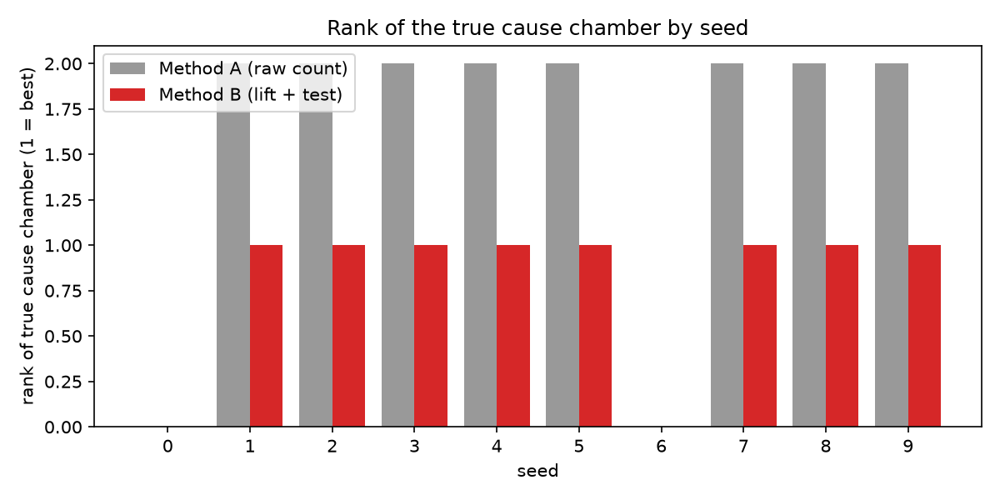

# E3 요약: 시드별 원인 분석 성능

> `scripts/run_e3.py`가 자동 생성한다. 해석은 실험 기록 E3에 있다.

평가 시드: 0, 1, 2, 3, 4, 5, 6, 7, 8, 9. 분류기는 `cnn_v1`로 고정했다.

## 요약

| 항목 | 값 |
| --- | --- |
| seeds | 10 |
| detected | 8/10 |
| detected_rule1_only | 7/10 |
| bottleneck_top1_a | 8/10 |
| top1_a | 0/10 |
| top1_b | 8/10 |
| top3_b | 8/10 |
| cause_found | 8/10 |
| seeds_with_rule2_extra_days | 7/10 |
| false_causes_total | 1 |
| other_pattern_alarms_total | 4 |
| rank_a_median | 2.0 |
| lot_precision_0h | 0.795 (최소 0.000) |
| lot_recall_0h | 0.538 (최소 0.000) |
| wafer_recall_0h | 0.534 (최소 0.000) |
| seeds_missing_lots_0h | 10/10 |
| lot_precision_12h | 0.779 (최소 0.000) |
| lot_recall_12h | 0.581 (최소 0.000) |
| wafer_recall_12h | 0.576 (최소 0.000) |
| seeds_missing_lots_12h | 9/10 |
| lot_precision_24h | 0.739 (최소 0.000) |
| lot_recall_24h | 0.630 (최소 0.000) |
| wafer_recall_24h | 0.634 (최소 0.000) |
| seeds_missing_lots_24h | 9/10 |

## 시드별

| seed | detected | window | rank_a | rank_b | cause_found | false_causes | rule1_days | rule2_extra_days | lot_recall_0h | lot_recall_24h | lot_precision_24h | other_pattern_alarms |
| --- | --- | --- | --- | --- | --- | --- | --- | --- | --- | --- | --- | --- |
| 0 | False |  | nan | nan | False | 0 | 0 | 0 | 0.000 | 0.000 | 0.000 | 0 |
| 1 | True | 17-18 | 2.000 | 1.000 | True | 0 | 1 | 1 | 0.375 | 0.500 | 0.889 | 0 |
| 2 | True | 13-17 | 2.000 | 1.000 | True | 0 | 1 | 2 | 0.600 | 0.800 | 1.000 | 0 |
| 3 | True | 14-19 | 2.000 | 1.000 | True | 0 | 2 | 3 | 0.864 | 0.909 | 0.800 | 2 |
| 4 | True | 13-18 | 2.000 | 1.000 | True | 1 | 2 | 2 | 0.900 | 1.000 | 0.952 | 0 |
| 5 | True | 15-19 | 2.000 | 1.000 | True | 0 | 1 | 3 | 0.750 | 0.875 | 0.933 | 2 |
| 6 | False |  | nan | nan | False | 0 | 0 | 0 | 0.000 | 0.000 | 0.000 | 0 |
| 7 | True | 13-17 | 2.000 | 1.000 | True | 0 | 4 | 0 | 0.862 | 0.931 | 0.931 | 0 |
| 8 | True | 14-16 | 2.000 | 1.000 | True | 0 | 3 | 1 | 0.625 | 0.750 | 1.000 | 0 |
| 9 | True | 13-15 | 2.000 | 1.000 | True | 0 | 0 | 2 | 0.400 | 0.533 | 0.889 | 0 |

참고 (개발용 seed 42, 평가에서 제외): 방법 A 2위, 방법 B 1위, 24시간 로트 recall 1.000, precision 0.905

