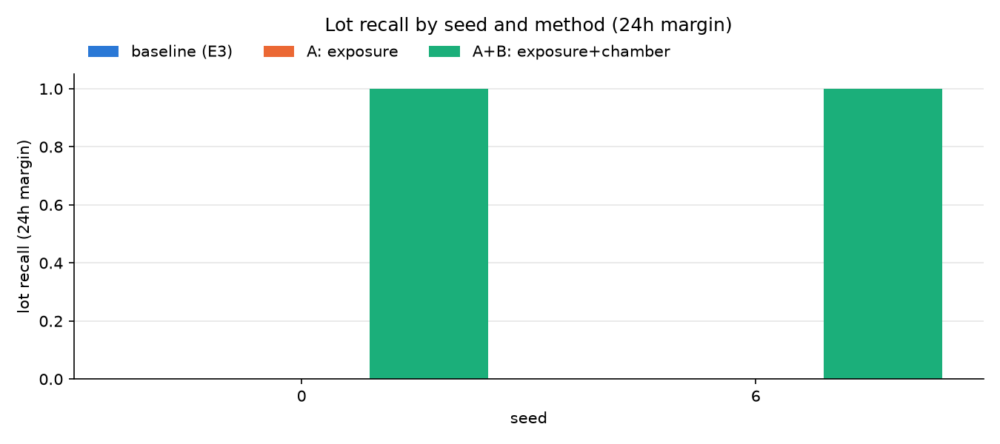

# E4 요약: 챔버 단위 개선 효과

> `scripts/run_e4.py`가 자동 생성한다. 해석은 실험 기록 E4에 있다.

평가 시드: 0, 6. 분류기는 `cnn_v1`, 여유 24시간.

## 가설 판정

기준(실행 전에 정함): 가설 2는 로트를 놓친 시드 1개 이하, 가설 3은 추가 보류 정상 로트 평균 3개 이하. baseline 대 exposure+chamber.

| 가설 | 판정 | 근거 |
| --- | --- | --- |
| 1 | 지지 | 감지 0/2 -> 2/2 |
| 2 | 판정 불가 | 감지된 시드 lot recall nan -> 1.000, 로트를 놓친 시드 0/2 (기준 1 이하) |
| 3 | 판정 불가 | 두 방법 모두 감지한 시드 없음 |
| 4 | 지지 | 잘못 지목한 원인(모든 Finding) 0 -> 0 |

## 방법별 요약

| method | seeds | detected | cause_found | top1_b | lot_recall_24h_detected | lot_recall_24h_all | lot_precision_24h_detected | seeds_missing_lots_24h | extra_lots_24h_detected | wrong_causes_all | false_causes_first | other_pattern_alarms | chamber_alarms | alarms_confirmed |
| --- | --- | --- | --- | --- | --- | --- | --- | --- | --- | --- | --- | --- | --- | --- |
| baseline | 2 | 0 | 0 | 0 | nan | 0.000 | nan | 2 | nan | 0 | 0 | 0 | 0 | 0 |
| exposure | 2 | 0 | 0 | 0 | nan | 0.000 | nan | 2 | nan | 0 | 0 | 0 | 0 | 0 |
| exposure+chamber | 2 | 2 | 2 | 2 | 1.000 | 1.000 | 0.683 | 0 | 9.000 | 0 | 0 | 0 | 3 | 2 |

## 시드별

| seed | method | detected | window | rank_b | cause_found | wrong_causes_all | lot_recall_24h | lot_precision_24h | extra_lots_24h | chamber_alarms | alarms_confirmed |
| --- | --- | --- | --- | --- | --- | --- | --- | --- | --- | --- | --- |
| 0 | baseline | False |  | nan | False | 0 | 0.000 | 0.000 | 0 | 0 | 0 |
| 0 | exposure | False |  | nan | False | 0 | 0.000 | 0.000 | 0 | 0 | 0 |
| 0 | exposure+chamber | True | 13-19 | 1.000 | True | 0 | 1.000 | 0.789 | 4 | 1 | 1 |
| 6 | baseline | False |  | nan | False | 0 | 0.000 | 0.000 | 0 | 0 | 0 |
| 6 | exposure | False |  | nan | False | 0 | 0.000 | 0.000 | 0 | 0 | 0 |
| 6 | exposure+chamber | True | 12-19 | 1.000 | True | 0 | 1.000 | 0.576 | 14 | 2 | 1 |

