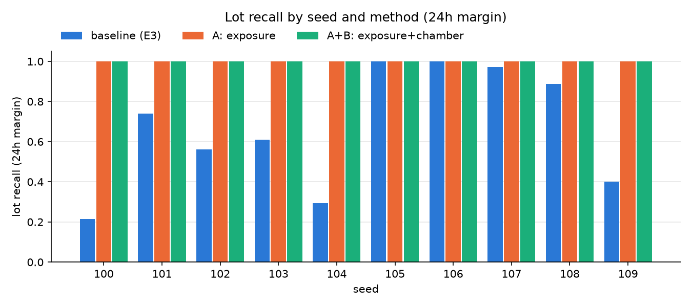

# E4 요약: 챔버 단위 개선 효과

> `scripts/run_e4.py`가 자동 생성한다. 해석은 실험 기록 E4에 있다.

평가 시드: 100, 101, 102, 103, 104, 105, 106, 107, 108, 109. 분류기는 `cnn_v1`, 여유 24시간.

## 가설 판정

기준(실행 전에 정함): 가설 2는 로트를 놓친 시드 1개 이하, 가설 3은 추가 보류 정상 로트 평균 3개 이하. baseline 대 exposure+chamber.

| 가설 | 판정 | 근거 |
| --- | --- | --- |
| 1 | 판정 불가 | 감지 10/10 -> 10/10 |
| 2 | 지지 | 감지된 시드 lot recall 0.668 -> 1.000, 로트를 놓친 시드 0/10 (기준 1 이하) |
| 3 | 지지 | 두 방법 모두 감지한 시드 10개에서 추가 보류 정상 로트 평균 +2.1개 (기준 3 이하) |
| 4 | 지지 | 잘못 지목한 원인(모든 Finding) 0 -> 0 |

## 방법별 요약

| method | seeds | detected | cause_found | top1_b | lot_recall_24h_detected | lot_recall_24h_all | lot_precision_24h_detected | seeds_missing_lots_24h | extra_lots_24h_detected | wrong_causes_all | false_causes_first | other_pattern_alarms | chamber_alarms | alarms_confirmed |
| --- | --- | --- | --- | --- | --- | --- | --- | --- | --- | --- | --- | --- | --- | --- |
| baseline | 10 | 10 | 10 | 10 | 0.668 | 0.668 | 0.854 | 8 | 1.800 | 0 | 0 | 2 | 0 | 0 |
| exposure | 10 | 10 | 10 | 10 | 1.000 | 1.000 | 0.824 | 0 | 3.900 | 0 | 0 | 2 | 0 | 0 |
| exposure+chamber | 10 | 10 | 10 | 10 | 1.000 | 1.000 | 0.824 | 0 | 3.900 | 0 | 0 | 2 | 27 | 0 |

## 시드별

| seed | method | detected | window | rank_b | cause_found | wrong_causes_all | lot_recall_24h | lot_precision_24h | extra_lots_24h | chamber_alarms | alarms_confirmed |
| --- | --- | --- | --- | --- | --- | --- | --- | --- | --- | --- | --- |
| 100 | baseline | True | 12-13 | 1 | True | 0 | 0.214 | 0.600 | 2 | 0 | 0 |
| 100 | exposure | True | 12-13 | 1 | True | 0 | 1.000 | 0.737 | 5 | 0 | 0 |
| 100 | exposure+chamber | True | 12-13 | 1 | True | 0 | 1.000 | 0.737 | 5 | 2 | 0 |
| 101 | baseline | True | 15-18 | 1 | True | 0 | 0.739 | 1.000 | 0 | 0 | 0 |
| 101 | exposure | True | 15-18 | 1 | True | 0 | 1.000 | 0.852 | 4 | 0 | 0 |
| 101 | exposure+chamber | True | 15-18 | 1 | True | 0 | 1.000 | 0.852 | 4 | 2 | 0 |
| 102 | baseline | True | 14-16 | 1 | True | 0 | 0.562 | 1.000 | 0 | 0 | 0 |
| 102 | exposure | True | 14-16 | 1 | True | 0 | 1.000 | 0.889 | 2 | 0 | 0 |
| 102 | exposure+chamber | True | 14-16 | 1 | True | 0 | 1.000 | 0.889 | 2 | 2 | 0 |
| 103 | baseline | True | 17-19 | 1 | True | 0 | 0.609 | 0.824 | 3 | 0 | 0 |
| 103 | exposure | True | 17-19 | 1 | True | 0 | 1.000 | 0.852 | 4 | 0 | 0 |
| 103 | exposure+chamber | True | 17-19 | 1 | True | 0 | 1.000 | 0.852 | 4 | 3 | 0 |
| 104 | baseline | True | 15-16 | 1 | True | 0 | 0.294 | 1.000 | 0 | 0 | 0 |
| 104 | exposure | True | 15-16 | 1 | True | 0 | 1.000 | 0.773 | 5 | 0 | 0 |
| 104 | exposure+chamber | True | 15-16 | 1 | True | 0 | 1.000 | 0.773 | 5 | 4 | 0 |
| 105 | baseline | True | 13-18 | 1 | True | 0 | 1.000 | 0.929 | 2 | 0 | 0 |
| 105 | exposure | True | 13-18 | 1 | True | 0 | 1.000 | 0.867 | 4 | 0 | 0 |
| 105 | exposure+chamber | True | 13-18 | 1 | True | 0 | 1.000 | 0.867 | 4 | 4 | 0 |
| 106 | baseline | True | 13-18 | 1 | True | 0 | 1.000 | 0.875 | 3 | 0 | 0 |
| 106 | exposure | True | 13-18 | 1 | True | 0 | 1.000 | 0.778 | 6 | 0 | 0 |
| 106 | exposure+chamber | True | 13-18 | 1 | True | 0 | 1.000 | 0.778 | 6 | 1 | 0 |
| 107 | baseline | True | 12-18 | 1 | True | 0 | 0.972 | 0.972 | 1 | 0 | 0 |
| 107 | exposure | True | 12-18 | 1 | True | 0 | 1.000 | 0.973 | 1 | 0 | 0 |
| 107 | exposure+chamber | True | 12-18 | 1 | True | 0 | 1.000 | 0.973 | 1 | 4 | 0 |
| 108 | baseline | True | 13-17 | 1 | True | 0 | 0.889 | 0.941 | 1 | 0 | 0 |
| 108 | exposure | True | 13-17 | 1 | True | 0 | 1.000 | 0.900 | 2 | 0 | 0 |
| 108 | exposure+chamber | True | 13-17 | 1 | True | 0 | 1.000 | 0.900 | 2 | 2 | 0 |
| 109 | baseline | True | 18-19 | 1 | True | 0 | 0.400 | 0.400 | 6 | 0 | 0 |
| 109 | exposure | True | 18-19 | 1 | True | 0 | 1.000 | 0.625 | 6 | 0 | 0 |
| 109 | exposure+chamber | True | 18-19 | 1 | True | 0 | 1.000 | 0.625 | 6 | 3 | 0 |

