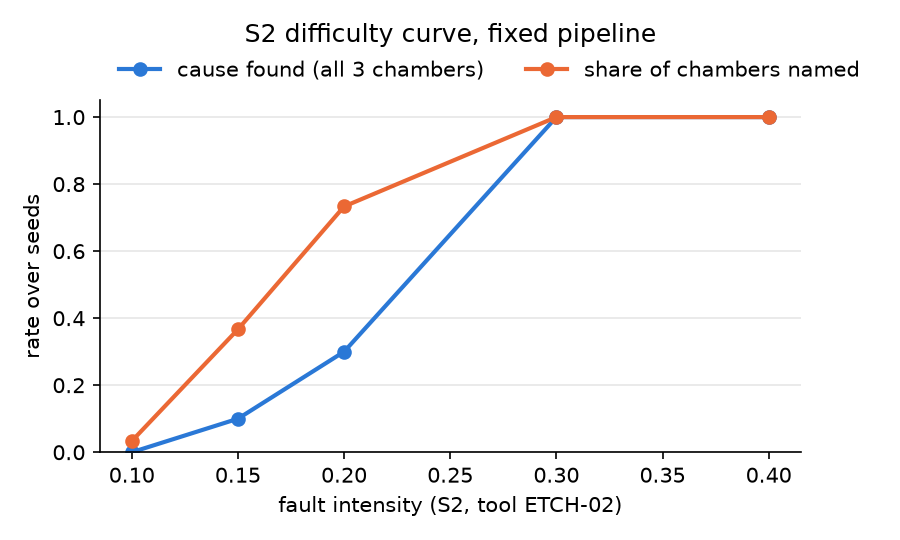

# E6 요약: 고정 파이프라인의 시나리오별 기준선

> `scripts/run_e6.py`가 자동 생성한다. 해석은 실험 기록 E6에 있다.

방법 `exposure+chamber`, 시드 200, 201, 202, 203, 204, 205, 206, 207, 208, 209. 채점은 `scoring.score_general`.

## 가설 판정

기준(실행 전에 정함): 실패는 10개 중 3개 이상, S1 로트를 놓친 시드 1개 이하, S3 두 원인 모두 찾음 8개 이상, S5 원인 없음 9개 이상.

| 가설 | 판정 | 근거 |
| --- | --- | --- |
| 1 | 지지 | 원인 찾음 10/10, 로트를 놓친 시드 0 (기준 1 이하) |
| 2 | 지지 | 못 찾은 시드 7/10 (기준 3 이상), 지목한 챔버 비율 평균 0.73 |
| 3 | 지지 | 두 원인 모두 찾음 10/10 (기준 8 이상), 진짜가 아닌 원인이 나온 시드 6 (기준 3 이상) |
| 4 | 지지 | 원인을 지목하지 않은 시드 10/10 (기준 9 이상) |
| 5 | 지지 | 시드당 진짜가 아닌 원인 S1 0.1, S2@0.4 0.9, S3 0.8 |
| 6 | 지지 | 강도별 원인 특정률 0.1: 0.0, 0.15: 0.1, 0.2: 0.3, 0.3: 1.0, 0.4: 1.0 |

## 시나리오별

| 시나리오 | 시드 | 찾은 원인 / 정답 원인 | 원인 precision | 시드당 진짜가 아닌 원인 | lot recall (전체) | 추가 보류 (전체) | 보류 로트 |
| --- | --- | --- | --- | --- | --- | --- | --- |
| S1 | 10 | 10/10 | 0.95 | 0.10 | 1.00 | 5.20 | 23.70 |
| S2@0.1 | 10 | 0/10 | 1.00 | 0.00 | 0.09 | 0.20 | 2.60 |
| S2@0.15 | 10 | 1/10 | 0.96 | 0.10 | 0.49 | 3.70 | 13.90 |
| S2@0.2 | 10 | 3/10 | 0.91 | 0.40 | 0.91 | 10.00 | 27.80 |
| S2@0.3 | 10 | 10/10 | 0.92 | 0.40 | 1.00 | 10.30 | 29.40 |
| S2@0.4 | 10 | 10/10 | 0.81 | 0.90 | 1.00 | 22.40 | 41.50 |
| S3 | 10 | 20/20 | 0.77 | 0.80 | 1.00 | 29.10 | 75.40 |
| S4 | 10 | 10/10 | 0.49 | 1.30 | 0.74 | 15.40 | 60.40 |
| S5 | 10 | 0/0 | - | 0.00 | - | 0.00 | 0.00 |

