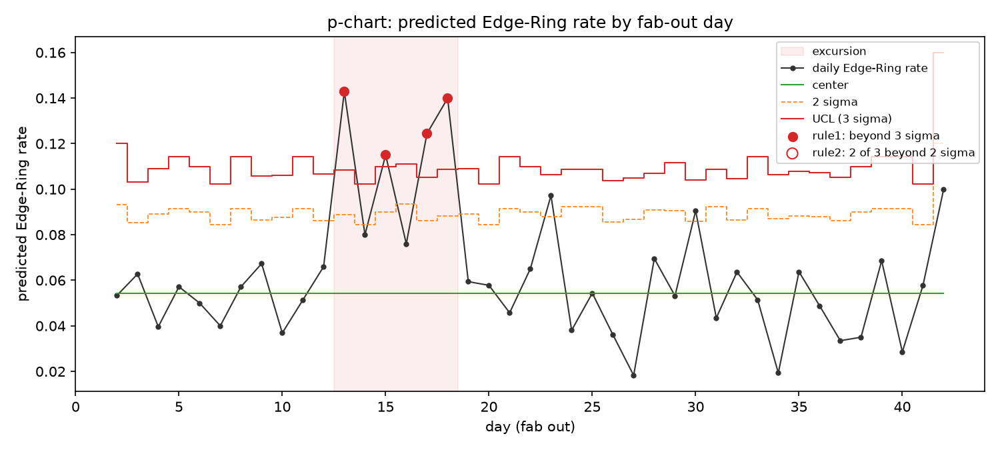
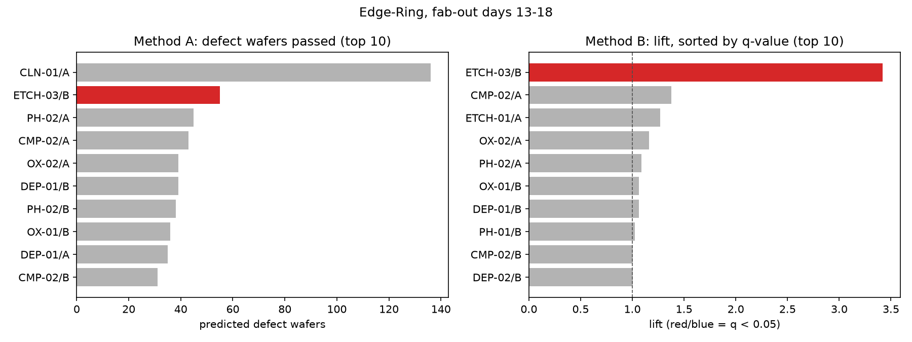

# 원인 분석 리포트: S1 (seed 42)

> `scripts/run_rca.py`가 자동 생성한다. 직접 고치지 말 것.

- 예측 모델: `cnn_v1`
- 격리 여유 시간: 24시간

## 1. 감시: 패턴별 이상 구간 (팹 아웃 날짜 기준)

| 패턴 | 이상 구간 |
| --- | --- |
| Edge-Ring | 13~18일차 |
| Edge-Loc | 없음 |
| Center | 없음 |
| Loc | 없음 |
| Scratch | 없음 |
| Random | 없음 |
| Donut | 없음 |
| Near-full | 없음 |

## 2.1 Edge-Ring, 13~18일차

구간에 팹 아웃된 웨이퍼 1,201장 중 예측 Edge-Ring 136장.

### 공통성 분석

방법 A(단순 집계) 1위: `CLN-01/A` (불량 웨이퍼 136장 경유)

방법 B 상위 후보:

| 순위 | 챔버 | 경유 | 불량 | 불량률 | lift | p | q | 유의 |
| --- | --- | --- | --- | --- | --- | --- | --- | --- |
| 1 | ETCH-03/B | 142 | 55 | 0.387 | 3.42 | < 0.0001 | < 0.0001 | O |
| 2 | CMP-02/A | 276 | 43 | 0.156 | 1.38 | 0.0088 | 0.1149 |  |
| 3 | ETCH-01/A | 153 | 22 | 0.144 | 1.27 | 0.1284 | 0.9893 |  |
| 4 | OX-02/A | 297 | 39 | 0.131 | 1.16 | 0.1522 | 0.9893 |  |
| 5 | PH-02/A | 365 | 45 | 0.123 | 1.09 | 0.2633 | 1.0000 |  |

### 결론과 격리 범위

- 원인 후보 `ETCH-03/B`: 노출 기간 01-11 06:43 ~ 01-19 05:14 (여유 24시간)
  - 출하 보류 로트 21개: L0082, L0087, L0088, L0095, L0099, L0100, L0106, L0107, L0108, L0109, L0110, L0111, L0112, L0119, L0123, L0124, L0125, L0130, L0134, L0139, L0141
  - 재검사 웨이퍼 176장

## 3. 채점 (여기만 정답지를 사용한다)

정답: `ETCH-03/B`, Edge-Ring, ETCH 통과 12~18일차

| 항목 | 값 |
| --- | --- |
| detected | True |
| false_alarm_windows_other_patterns | 0 |
| window | [13, 18] |
| rank_a | 2 |
| rank_b | 1 |
| top1_a | False |
| top1_b | True |
| top3_b | True |
| bottleneck_top1_a | True |
| causes | ETCH-03/B |
| cause_found | True |
| false_causes | [] |
| held_lots | 21 |
| lot_precision | 0.905 |
| lot_recall | 1.000 |
| missed_lots | [] |
| extra_lots | L0082, L0141 |
| wafer_precision | 0.903 |
| wafer_recall | 1.000 |
